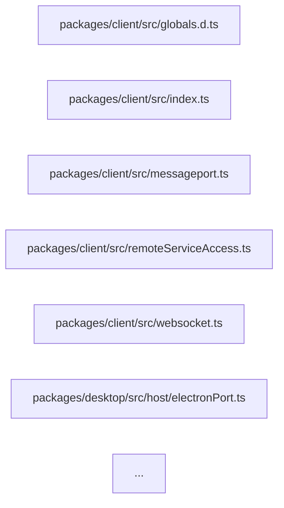

# ZCode 工程治理分析（对照 dsh）

> **分析对象**：`github.com/zai-org/ZCode`，本地克隆 `.ref-zcode/ZCode`，HEAD `aac4755`（`feat: update to v3.15.1`），`package.json` version `3.15.1`。
> **方法**：只读分析。所有结论来自工作树（working tree），逐条给出 `path:line` 或逐字引文。
> **⚠️ 方法学限制（必须写进文章）**：本仓库只有 **4 个提交**——`77432b6d Initial commit`、`872ad960 feat: open source`、`29628c9a feat: update v3.14.3`、`aac47556 feat: update to v3.15.1`。这是一次**压缩导入（squashed import）**式开源，正常的 git 历史**不可用**。因此本报告**无法**做任何演化分析：无法回答「架构策略是什么时候引入的」「ADR 是在哪次提交后停写的」「baseline 是被哪次提交填满又清空的」「`managed: true` 的模块是按什么节奏逐个迁移的」。所有关于「演进」「ratchet 收紧过程」「治理成熟度曲线」的判断在本仓库**只能停留在工作树快照**，不能当作时间线证据。文中凡涉及「这与历史有关」的推断，均已标注为**不可验证**。

---

## §1 `architecture-policy.yaml` + `scripts/architecture/architecture-check.mjs` —— 全仓最独特的产物

这是本仓库与 dsh 差距最大的一个东西：**dsh 靠机械门禁（lint / 类型 / 测试），ZCode 额外造了一套「可执行的架构政策 + 记忆化 ratchet」**。

### 1.1 政策文件是「组织级政策」，不是配置文件

`architecture-policy.yaml` 开头就把自己定性为组织资产：

```yaml
# architecture-policy.yaml:1-3
version: 1

# 存量模块先标记为 legacy；新模块或完成迁移的模块设置 managed: true。
```

配套的治理文档把设计意图说透了：

> 架构规则是全仓公共能力，不属于任何单一业务重构。所有代码变更经过同一条链路：
> ```text
> 代码变更 → 策略解析 → 依赖图与变更闭包 → 规则检查与 ratchet → 阅读包与报告
> ```
> —— `docs/architecture/architecture-governance.md:5-9`

> - 根目录 `architecture-policy.yaml` 是组织级政策：模块路径、层级、允许边、全局阈值和例外。
> - 模块 `module.ts` 是局部依赖声明：`id`、`requires`、`provides` 和公开入口。
> - 实际 import graph 从源码生成，不能手工维护。
> - feature graph 只描述产品能力和影响面，不承担架构门禁职责。
> —— `docs/architecture/architecture-governance.md:15-18`

最后一行的边界划分很值得写：**他们明确拒绝让 feature graph 兼任政策**（`architecture-governance.md:68` 再次强调「不让 feature graph 兼任政策」）。也就是「影响面发现」和「架构门禁」是两套东西，两套都不许越界。

### 1.2 模块注册表：字段逐个说清

`policy.mjs:33-76` 定义了全部字段的解析与默认值。一个模块登记项长这样（取最完整的 `storage`）：

```yaml
# architecture-policy.yaml:26-33
  - id: storage
    roots: [packages/services/src/storage]
    managed: true
    requires: [shared, rpc, services]
    publicEntrypoints: [packages/services/src/storage/contract.ts]
    layers: { domain: domain, app: app, adapters: adapters }
    layerOrder: [domain, app, adapters]
    owner: desktop-settings
```

| 字段 | 含义 | 解析/校验位置 |
| --- | --- | --- |
| `id` | 模块唯一标识（目录名不必相同，`storage` 只是 `packages/services/src` 下的子目录） | `policy.mjs:39-41`，重复或为空直接抛 `模块 id 重复或为空` |
| `roots` | 该模块**拥有的源码根目录**，可多个（`plugin-sandbox` 就登记了 4 个 root，跨 desktop 的 main/host/preload/renderer，见 `architecture-policy.yaml:141-145`） | `policy.mjs:42-44`——`必须声明 roots` |
| `managed` | 是否纳入强制检查，**只有 `=== true` 才算**（`managed: module.managed === true`，`policy.mjs:48`） | — |
| `requires` | 允许依赖的模块 id 白名单，**去重后**存入（`policy.mjs:49`） | `policy.mjs:57-62` 校验「依赖的模块必须存在」，否则 `模块 X 依赖未知模块 Y` |
| `publicEntrypoints` | 跨模块唯一可 import 的入口文件 | `policy.mjs:50`；强制在 `index.mjs:260-274`（deep-import 规则） |
| `layers` | 层名 → 目录（相对 root）映射，`"."` 表示根本身 | `policy.mjs:51` |
| `layerOrder` | 层序，缺省 = `Object.keys(layers)` 顺序 | `policy.mjs:52` |
| `owner` | 责任人/责任团队，参与报告输出 | `policy.mjs:53`，缺省 `null` |

**`owner` 的实际取值极有信息量**——它不是个人，而是**领域名**：`conversation`、`desktop-settings`、`plugin`。`conversation` 出现在 `session` / `gen-ui-protocol` / `gen-ui-service` / `gen-ui` 四个模块上，`plugin` 出现在 `mcp-apps-protocol` / `mcp-ui` / `plugin-ui-bridge` / `plugin-sandbox` / `plugin-ui` 五个模块上。**这意味着一份「模块 → 领域 owner」的责任地图已经沉进 YAML**，而不是散在 CODEOWNERS 里。

### 1.3 `managed: true` vs `false`：整个治理的核心开关

这是全套设计里最聪明也最诚实的一点。政策的注释已经写明规则，而体检报告式的证据在治理文档里：

```yaml
# architecture-policy.yaml:3
# 存量模块先标记为 legacy；新模块或完成迁移的模块设置 managed: true。
```

**语义上**：`managed: false` = 遗留模块（legacy），登记只为**发现源码 + 生成阅读包**，不受任何规则约束；`managed: true` = 已迁移模块，**全规则强制 + 必须齐备模块产物**。

实测分布：全仓共登记 **27 个模块**，**只有 10 个是 `managed: true`**（`storage`、`gen-ui-protocol`、`gen-ui-service`、`gen-ui`、`mcp-apps-protocol`、`mcp-ui`、`plugin-ui-bridge`、`plugin-sandbox`、`plugin-ui`——数一下 YAML 中 `managed: true` 的出现次数即可核对）。而最庞大的存量模块全部是 `false`：`rpc`（`architecture-policy.yaml:5-7`）、`shared`（`:8-10`）、`provider`（`:11-13`）、`client`（`:34-36`）、`server`（`:37-39`）、`ui`（`:43-45`）、`web`（`:46-48`）、`desktop`（`:49-51`）、`zcode-cli`（`:61-63`）等等。

配套的文档把「假绿灯」风险写成了正式条目：

> 当前 `managedOnly: true` 下的零违规仅表示已启用规则没有报错，不证明所有存量跨域依赖已通过机械检查；Provider/Selection 交集仍执行人工双向复审。
> —— `docs/architecture/architecture-governance.md:72`

**这一句必须引用进文章**。它是一个团队对自己门禁的**能力边界公告**：检查器绿了 ≠ 架构对了。SKILL.md 里也重复了一次：

> Check the actual managed-module coverage before claiming the gate verifies a boundary: a passing result does not prove unconfigured modules or runtime semantics are correct.
> —— `.agents/skills/architecture-governance/SKILL.md:43`

### 1.4 层级模型（domain / app / adapters）与依赖方向

层定义在模块级，**每个模块可以有自己的层集合**，这与 dsh 那种「统一分层」不同：

```yaml
# architecture-policy.yaml:31-32  (storage)
    layers: { domain: domain, app: app, adapters: adapters }
    layerOrder: [domain, app, adapters]
```

```yaml
# architecture-policy.yaml:96-97  (gen-ui) —— 多了 ui 层
    layers: { domain: domain, app: app, adapters: adapters, ui: components }
    layerOrder: [domain, app, adapters, ui]
```

```yaml
# architecture-policy.yaml:111-112  (mcp-apps-protocol) —— 只有一层，"." = root 即 domain
    layers:
      domain: "."
```

**依赖方向规则**（`index.mjs:214-233`）：只有当 importer 与 target 同属一个模块、且**两层的索引都在 `layerOrder` 里**、且 `indexOf(importer) < indexOf(target)` 时，才判违规。即 **`layerOrder` 是「由低到高」，你只能依赖索引更大（更高）的层**，消息是：

```js
// scripts/architecture/index.mjs:229
          message: `层 ${importerLayer} 不能依赖更高层 ${targetLayer}`,
```

注意 `layerOrder` 里的 `domain` 排在最前 = 最低层，`adapters`/`ui` 排最后 = 最高层。这与直觉的「domain 是核心」一致：核心不依赖外设。

**domain 层的额外硬约束**（两条，`index.mjs:196-209` 与 `:276-286`）：

```js
// scripts/architecture/index.mjs:196-208
      if (
        importerLayer === "domain" &&
        /^(node:|fs$|path$|http$|https$|net$|child_process$|timers$)/.test(specifier)
      ) {
        violations.push(
          violation({
            rule: "domain-io",
            ...
            message: "domain 层不能依赖 IO、进程、网络或定时器",
```

```js
// scripts/architecture/index.mjs:276-286  —— 连 fetch/setTimeout/setInterval 的「调用」都禁
    if (importerLayer === "domain" && /\b(fetch|setTimeout|setInterval)\s*\(/.test(source)) {
```

即 domain 层**既不能 import IO 模块，也不能调用 IO 函数**——这是用正则做的「纯净性」检查，粗糙但有效。SKILL.md 把这条写成设计原则：

> - **Explicit boundaries:** choose the layer for every new file and the public contract for every cross-module edge. Keep `ui → hooks/services → app → domain → adapters` and keep IO out of domain.
> —— `.agents/skills/architecture-governance/SKILL.md:18`

注意这里的箭头方向 `ui → hooks/services → app → domain → adapters` **表述得有点反直觉**（箭头指向被依赖方？还是依赖方向？），而 YAML 里 `adapters` 排最高层、可以依赖 domain。两条表述的精确语义有张力——**这是一个可以谨慎指出的细节不一致**（不可据此断言设计错误，但值得文章提一句「政策文本与文档文本的方向描述需要读者自行对齐」）。

### 1.5 全局阈值 + 例外机制

```yaml
# architecture-policy.yaml:179-185
global:
  maxFileLines: 400
  maxContractLines: 300
  maxPublicMethods: 12
  forbidCycles: true
  forbidDeepImports: true
  managedOnly: true
```

对应 5 类违规（`index.mjs`）：

| 规则 | 阈值 | 判定 | 消息（逐字） |
| --- | --- | --- | --- |
| `max-file-lines` | 400 | `lines > maxFileLines` | `` `文件 ${lines} 行，超过上限 ${policy.global.maxFileLines} 行` `` (`index.mjs:150`) |
| `max-contract-lines` | 300 | 文件名以 `contract.` 开头 | `` `契约 ${lines} 行，超过上限 ${policy.global.maxContractLines}` `` (`index.mjs:161`) |
| `max-public-methods` | 12 | 用 TS AST 数 `contract.ts` 里的方法签名（`countPublicMethods`，`policy.mjs:107-125`） | `` `契约公开方法超过上限 ${policy.global.maxPublicMethods}` `` (`index.mjs:189`) |
| `disable-count` | 0 | 数 `oxlint-disable` / `eslint-disable` 行 | `` `文件包含 ${disableCount} 条 lint disable` `` (`index.mjs:175`) |
| `missing-module-artifact` | — | managed 模块必须齐备 5 件产物 | `` `模块 ${module.id} 缺少 ${artifact}` `` (`index.mjs:129`) |

**`disable-count` 阈值是 0** —— 这是全套里最硬的一条：

```js
// scripts/architecture/index.mjs:165-168
    const disableCount = source
      .split(/\r?\n/)
      .filter((line) => /(?:oxlint|eslint)-disable/.test(line)).length;
    if (disableCount > 0 && !isException(policy, "disable-count", file, cwd)) {
```

在一个 **managed 模块**里写一行 `oxlint-disable` 就会失败。规则目录给出的修复指引是：

> | `disable-count` | Managed code adds a lint suppression | Fix the underlying violation or add a reviewed expiring exception |
> —— `.agents/skills/architecture-governance/references/rule-catalog.md:13`

**「不许用 disable 掩盖」被机械化了**。这与 dsh 依赖 lint 配置的做法是两个层次。

**managed 模块必须齐备的 5 件产物**（`index.mjs:113-119`）：

```js
// scripts/architecture/index.mjs:113-119
    const required = [
      "module.ts",
      "contract.ts",
      "contract.example.ts",
      "contract.test.ts",
      "CONTRACT.md",
    ];
```

即：**manifest + 契约 + 契约示例 + 契约测试 + 契约文档**，四件套加文档，缺一即失败。SKILL.md 也重申：

> For a new managed module, provide `module.ts`, `contract.ts`, `contract.example.ts`, `contract.test.ts`, and a short `CONTRACT.md`.
> —— `.agents/skills/architecture-governance/SKILL.md:45`

**例外机制**（`architecture-policy.yaml:187-195`）带 `id` / `rule` / `paths` / `reason`，并且支持**过期**：

```yaml
# architecture-policy.yaml:188-191
  - id: gen-ui-tweak-runtime-size
    rule: max-file-lines
    paths: [packages/desktop/src/renderer/src/plugin-sandbox/genUiTweakRuntime.js]
    reason: Keep parameter binding and registration lifecycle together; runtime-manifest.json and tests verify file integrity.
```

```js
// scripts/architecture/index.mjs:91-102  —— 例外可以带 expires，过期即违规
  for (const exception of policy.exceptions) {
    if (exception.expires && exception.expires < today) {
      violations.push(
        violation({
          rule: "expired-exception",
          ...
          message: `例外 ${exception.id ?? exception.rule} 已于 ${exception.expires} 过期`,
```

**「例外必须带理由、且可以设过期日、过期后自己变成违规」**——这是治理设计里很成熟的一手。当前仓库的 2 条例外都**没有设 `expires`**（这是可以指出的观察：过期机制已实现但尚未被使用）。

### 1.6 `architecture:check --changed` 到底强制什么

这是「快」的关键。`--changed` **不是只查改动文件**，而是查**改动的传递影响闭包**：

```js
// scripts/architecture/index.mjs:295-309
  if (changed) {
    const reverse = new Map(files.map((file) => [file, []]));
    for (const [from, targets] of edges)
      for (const target of targets) reverse.get(target)?.push(from);
    const queue = [...changed];
    while (queue.length > 0) {
      const current = queue.shift();
      for (const dependent of reverse.get(current) ?? []) {
        if (!changed.has(dependent)) {
          changed.add(dependent);
          queue.push(dependent);
        }
      }
    }
  }
```

建**反向依赖图**，从改动点做 BFS，把所有**传递依赖者**纳入范围。然后：

```js
// scripts/architecture/index.mjs:310-314
  const scoped = changed
    ? violations.filter((item) => item.global || changed.has(path.resolve(cwd, item.file)))
    : violations;
  const baselineViolations = scoped.filter((item) => baselineFingerprints.has(item.fingerprint));
  const newViolations = scoped.filter((item) => !baselineFingerprints.has(item.fingerprint));
```

**`item.global` 的违规永远参与判定，不受 `--changed` 范围限制**——即循环依赖（`cycle`）、过期例外（`expired-exception`）是全局的。治理文档把这三件事列全了：

> `--changed` 解析完整依赖图，但只对本次变更及其必要影响闭包阻断；全局策略、循环依赖和 baseline 增长始终检查。CI 不得自动刷新 baseline。
> —— `docs/architecture/architecture-governance.md:36`

改动文件从哪来？`changedFilesFromGit` 用 **NUL 分隔流式输出**，同时取已跟踪 diff 与未跟踪文件：

```js
// scripts/architecture/index.mjs:325-331
export async function changedFilesFromGit(cwd = process.cwd()) {
  const [diff, untracked] = await Promise.all([
    gitFileNames(cwd, ["diff", "--name-only", "-z", "HEAD"]),
    gitFileNames(cwd, ["ls-files", "--others", "--exclude-standard", "-z"]),
  ]);
  return [...new Set([...diff, ...untracked])];
}
```

**这里有一条真实的踩坑记录**（治理文档专门留了一节）：

> 2026-09-10 的 macOS 打包任务在文件枚举阶段失败：Runner 保留的 `.electron-builder-cache` 未被 Git 忽略，`git ls-files --others --exclude-standard` 输出超过 `execFile` 默认缓冲区。
> —— `docs/architecture/architecture-governance.md:40`

以及配套的三条原则（`:42-44`）：缓存目录进 `.gitignore`、用 NUL 流式避免 maxBuffer、**Git 进程失败时拒绝检查，不把失败或部分输出当成空变更通过**。最后这条是「fail-closed」的正面样本，值得引用：

> - 收集入口合并、去重文件名；Git 进程失败时拒绝检查，不把失败或部分输出当成空变更通过。
> —— `docs/architecture/architecture-governance.md:44`

### 1.7 baseline / ratchet 怎么工作

**`.architecture-baseline.json` 当前是空的**：

```json
// .architecture-baseline.json （全文，3 行）
{
  "version": 1,
  "violations": []
}
```

机制在代码里（`index.mjs:290-315` 见上）。核心是**指纹（fingerprint）**：

```js
// scripts/architecture/index.mjs:20-22
function fingerprint(rule, file, detail = "") {
  return createHash("sha256").update(`${rule}\0${file}\0${detail}`).digest("hex").slice(0, 16);
}
```

指纹 = `sha256(rule \0 file \0 detail)` 的前 16 位 hex。于是：

- `violations` = 本次范围内的**全部**违规
- `baselineViolations` = 指纹命中 baseline 的（= 已知存量，**不阻断**）
- `newViolations` = 指纹不在 baseline 的（= 新增，**阻断**）

退出码只看 `newViolations`：

```js
// scripts/architecture/architecture-check.mjs:38-39
console.log(formatReport(result));
process.exit(result.newViolations.length > 0 ? 1 : 0);
```

`formatReport` 的输出格式（`index.mjs:369-379`）：

```js
    `architecture: ${result.newViolations.length === 0 ? "OK" : "FAILED"}`,
    `violations: ${result.violations.length}`,
    `baseline: ${result.baselineViolations.length}`,
    `new: ${result.newViolations.length}`,
```

每个新违规一行 `- ${item.rule} ${item.file}: ${item.message}`。

**baseline 只能显式更新**（`architecture-check.mjs:25-29`）：

```js
if (command === "baseline:update") {
  await updateBaseline({ cwd, violations: result.violations });
  console.log(`baseline updated: ${result.violations.length} violations`);
```

写入时**按指纹排序**，保证确定性（`index.mjs:319`）：`[...violations].sort((a, b) => a.fingerprint.localeCompare(b.fingerprint))`。

治理文档写死了这条纪律：

> 存量违规进入确定性的 baseline；新违规阻断，baseline 只能通过显式命令和 PR 审核更新。
> —— `docs/architecture/architecture-governance.md:11`

> Use `pnpm architecture:baseline:update` only when a reviewed change intentionally changes the accepted legacy baseline. CI never refreshes baseline automatically.
> —— `.agents/skills/architecture-governance/SKILL.md:43`

**「ratchet 只能由人手动松」+「指纹化使得移动/重命名后的违规会重新变成新违规」**，这是比 dsh 的 lint 门禁高一个抽象层的东西。

### 1.8 阅读包（Reading package）—— 门禁顺手变成了上下文供给

`pnpm architecture:context <module-id>` 生成一份**给 agent 读的受限上下文**（`index.mjs:333-367`），输出结构固定：

```
# Architecture context: ${module.id}
owner: ${module.owner ?? "unassigned"}
managed: ${module.managed}
requires: ${module.requires.join(", ") || "none"}

## Files
- <module.ts 路径，缺失则写 "module.ts: missing">
- <各 contract.* 文件>
- public: <各 publicEntrypoint>

## Direct dependency contracts
- <依赖模块的 contract.ts 路径>

## Boundaries
- Cross-module imports must use declared requirements and public entrypoints.
- Add a contract example and contract test before exposing a new capability.
```

文档强调它**不复制实现**：

> 阅读包由代码和策略生成，包含目标模块的 `module.ts`、`contract.ts`、示例、契约测试、短 CONTRACT.md、直接依赖契约、owner、允许边和受影响测试，不复制完整实现。
> —— `docs/architecture/architecture-governance.md:60`

**这是把「架构门禁」和「AI 上下文供给」当成同一件事的两个面**——政策的产物既是检查输入，也是 agent 的工作集。这一条对写文章很关键：ZCode 的架构政策不是「拦人」的，它是「先让 agent 知道该在哪里写代码」的。

### 1.9 违规时的完整真实输出（可直接引用）

`formatMarkdownReport`（`index.mjs:381-396`）产出的报告头部：

```
# Architecture report

- Status: **FAILED**
- Violations: N
- Baseline: M
- New: K

## New violations

| Rule | File | Message |
| --- | --- | --- |
```

文本模式的真实格式（`formatReport`）在失败时形如：

```
architecture: FAILED
violations: 3
baseline: 1
new: 2
- layer-direction packages/services/src/storage/app/foo.ts: 层 app 不能依赖更高层 adapters
- deep-import packages/ui/src/gen-ui/x.ts: 跨模块只能通过公开入口访问 packages/services/src/storage/domain/bar.ts
```

（规则名与消息模板均逐字取自 `index.mjs:143-286` / `:369-379`；上面两行是按模板与真实规则串拼出的**示意输出**，用于展示格式，非仓库内的历史日志。）

### 1.10 治理工具自身有测试

`package.json:77` 有 `"test:architecture": "node --test scripts/test/architecture-governance.test.mjs"`。该测试用 `mkdtemp` 造临时 git 仓库 + 写 fixture 文件，再调 `checkArchitecture` / `changedFilesFromGit` / `updateBaseline`——**门禁本身被测试覆盖**（`scripts/test/architecture-governance.test.mjs:1-30`）。这一点 dsh 侧没有对应物。

---

## §2 `docs/adr/` 只有 4 个 ADR，而 `docs/*.md` 有 1866 个 —— 谁才是真正的决策记录

### 2.1 事实盘点

```bash
find docs -name '*.md' | wc -l   # => 1866
ls docs/adr/                     # => 4 个文件
```

`docs/` 下按目录分布的 md 数量（Top）：

| 目录 | md 数 |
| --- | ---: |
| `docs/electron/` | 280 |
| `docs/working-memory/` | 259 |
| `docs/superpowers/` | 253 |
| `docs/ui/` | 156 |
| `docs/webdriverio/` | 124 |
| `docs/testing/` | 82 |
| `docs/browser-use/` | 48 |
| `docs/knip/` | 47 |
| `docs/desktop/` | 44 |
| `docs/chat/` | 37 |
| `docs/monitoring/` | 34 |
| `docs/v4-refactor/` | 28 |
| `docs/architecture/` | 16 |
| **`docs/` 根层平铺** | **273** |

其中 `docs/knip/`、`docs/superpowers/`、`docs/browser-use/`、`docs/webdriverio/` 等明显是**第三方依赖包自带的文档被整体纳入**（`docs/knip/docs/README.md` 就是 knip 自己的 Astro 文档站源码，含 `astro.config.ts`、`public/favicon.ico`、`screenshots/fix.mp4`）。**1866 这个数字里有相当大一块是 vendored 文档，不是自写文档**——这一点在写文章时必须澄清，否则会把「文档纪律」这个结论建立在错误基数上。

### 2.2 真正的主流格式：**根目录平铺的 kebab-case 主题文件**

273 个自写文档平铺在 `docs/` 根层，文件名就是「主题 slug」，例如：

```
agent-subagent-provider-runtime-headers-routing.md
model-provider-coding-plan.md
conversation-product-state-space.md
plan-mode-goal-command-guard.md
workspace-project-removal-runtime-release.md
```

**它们没有统一模板，但有稳定的内部骨架**。以 `docs/agent-subagent-provider-runtime-headers-routing.md` 为例（这是最典型的「修复说明型」文档）：

```markdown
# Explore 子 agent provider runtime headers 路由说明

## 背景
...
## 问题
...
## 修复原则
...
## 影响范围
...
## 2026-09-08 请求隔离
```

即 **`背景 → 问题 → 修复原则 → 影响范围`**，且**末尾可以带日期追加节**（「2026-09-08 请求隔离」）。

而 `docs/model-provider-coding-plan.md` 是「领域说明型」，结构完全不同：`# Model Provider Coding Plan` → `## Entries` → `## Coding Plan States`，用条目式陈述当前产品规则，**没有背景/问题**。

**结论：这不是「一套模板」，是「一种文体约定」**——`docs/<kebab-topic>.md` = 一个主题的当前事实文档，内部结构随文体（修复说明 / 领域规则 / 架构决策 / 运行手册）自然变化。文首常有一句定位语，例如：

> 插件设置页及其市场浏览/安装体验的领域词汇表。2026-07 商店化重设计引入了一批容易混淆的术语，本文件是唯一裁决来源。
> —— `CONTEXT.md:3`（同类文体，可作旁证）

以及这类的范围声明：

> 修改 main/host/services 的进程职责、工作区隔离、session/task、输入队列、stream、snapshot 或远控链路前读取。这里只保留跨模块约束；具体实现以对应当前事实文档和契约为依据。
> —— `docs/agents/runtime-boundaries.md:3`

**「修改 X 前读取」是一个反复出现的触发器句式**，它把文档从「参考」变成了「前置条件」。

### 2.3 命名约定的可验证规则

从目录与文件名可以反推出几条**成文或不成文**的约定：

1. **自写文档 = 平铺 kebab-case，无编号**。`docs/` 根层没有任何 `0001-` 这样的前缀（数字编号只出现在 `docs/adr/` 和 `docs/issues/<feature>/<NN>-<slug>.md`）。
2. **子目录是「主题族」而非「文档类型」**：`docs/testing/`、`docs/monitoring/`、`docs/migration/`、`docs/performance/` 是族；但 `docs/plans/`、`docs/specs/`、`docs/issues/`、`docs/adr/` 是**类型**。两种约定**并存**。
3. **`*-plan.md` 与 `*-spec.md` 后缀是类型标记**：`architecture-governance.md:60` 提到「历史 plan/spec 仅作背景」，`docs/agents/runtime-boundaries.md:64` 写「修改上述远控/实时行为前，按问题读取以下当前事实文档；**历史 plan/spec 仅作背景**」。即：**plan/spec 是历史物，事实文档是权威物**。

### 2.4 有没有模板 / writer 脚本？

**有一个生成器，但只服务于一个审计**。`scripts/audit-conversation-session-case-coverage.mjs:44-59` 定义了 `GENERATED_MARKDOWN_DOCS`：

```js
// scripts/audit-conversation-session-case-coverage.mjs:44-52
const GENERATED_MARKDOWN_DOCS = {
  decisionAnswerTemplate:
    "docs/testing/conversation-session-next-decision-answer-template.md",
  decisionAnswersStatus:
    "docs/testing/conversation-session-decision-answers-status.md",
  decisionBackfillPlan:
    "docs/testing/conversation-session-decision-backfill-plan.md",
  decisionReviewQueue:
    "docs/testing/conversation-session-decision-review-queue.md",
  decisionWorkflowBoard:
    "docs/testing/conversation-session-decision-workflow-board.md",
  nextDecisionReview:
    "docs/testing/conversation-session-next-decision-review.md",
};
```

**这 6 个文档是脚本生成的**，且脚本还维护 `docs/conversation-session-case-catalog.md` 等 6 个**手写权威文档**（`DOCS` 常量，`:33-42`）。所以「手写权威 + 生成派生」是分开的，派生文档有专门的生成入口。

**没有全仓的文档生成器、没有模板引擎、没有 docs 脚手架。**

### 2.5 `docs/agents/instruction-maintenance.md` 说了什么

这份文档是**指令体系自身的治理文档**（不是文档治理，是**指令治理**），它的存在本身就值得写：

> 本规范描述仓库 AGENTS.md、Claude 入口和相关 skills 的组织与验收方式。目标优先级是减少返工、漏验和人工纠正，其次减少无必要的确认、阅读和重复测试。**文件长度只用于观察上下文开销，不作为效果提升的证明。**
> —— `docs/agents/instruction-maintenance.md:5`

最后一句差点就是在直接回应「AGENTS.md 越短越好」这类信条——**他们明确拒绝把长度当指标**。

它给出一张**文件分工表**（`instruction-maintenance.md:19-27`），规定「哪份文件负责什么 / 什么时候读」：

| 位置 | 负责的内容 | 读取条件 |
| --- | --- | --- |
| 根 AGENTS.md | 任务边界、spec、关键工程约束、验证与完成条件、阅读入口 | 所有仓库任务 |
| packages/ui/AGENTS.md | UI 服务访问、状态、平台适配、日志 | UI 组件、页面、样式或 hooks 变更 |
| packages/services/AGENTS.md | 服务日志和服务层注意事项 | 服务实现变更 |
| apps/zcode-cli/AGENTS.md | CLI 特有契约、工具链和验证 | CLI 代码变更 |
| docs/agents/runtime-boundaries.md | 进程、工作区身份、桌面/手机状态边界 | process、workspace 状态、远控或实时链路变更 |
| .claude/CLAUDE.md 与 CLI 对应入口 | 导入共享 AGENTS.md | Claude 加载项目指令 |
| 现有领域文档、skills | 领域事实、专用工具与工作流 | 根文件或任务命中对应触发条件 |

并有一条很务实的警告：

> 根文件必须写出「何时读哪个文件」，从仓库根目录启动的任务也能找到子目录规则。**不要假定新增嵌套 AGENTS.md 后，所有宿主都会在每次编辑文件时自动加载它。**
> —— `docs/agents/instruction-maintenance.md:29`

以及**反对补丁堆积**：

> 同类错误再次出现时，更新负责该决策的原始规则并增加一个代表场景。**避免在根文件、子目录文件和 skills 各追加一份修补要求。**
> —— `docs/agents/instruction-maintenance.md:52`

### 2.6 `docs/AGENTS.md` 不存在

```bash
ls docs/AGENTS.md   # => No such file or directory
```

根层 AGENTS.md 用一行把 `CONTEXT.md` 与 `DESIGN.md` 编入索引（`AGENTS.md:35-36`），但**没有给 docs/ 建索引文件**。`docs/` 下只有 4 个 README（`docs/trace/`、`docs/monitoring/`、`docs/webdriverio/`、`docs/v4-refactor/`）——**273 个平铺文档没有任何目录索引**。这是文档膨胀的直接后果，也是可以指出的治理缺口。

### 2.7 四个 ADR 本身

`docs/adr/` 的 4 个文件是**纯 ADR 格式**（Context / Decision / Consequences / Alternatives 子集），且**标题就是决策本身**（不是名词短语）：

- `0001-store-listing-in-marketplace-catalog.md:1` — `# Store Listing 元数据放在市场目录层，展示时目录优先、manifest 回退`
- `0002-plugin-store-style-deviation.md:1` — `# 插件商店页面有意偏离 DESIGN.md 的克制风格`
- `0003-marketplace-source-removal-keeps-installed-plugins.md:1` — `# 删除 Marketplace Source 时保留已安装插件`
- `0004-release-packaging-platform-contract.md:1` — `# Release Candidate 由打包平台托管`

**编号只到 0004，且四个都是 2026-07 ~ 2026-08 的商店/发布主题**。0004 的状态还是 `Proposed`（`:3`），0003 是 `Accepted`（`:3`），0001/0002 **完全没有状态行**。

值得注意的是 ADR 的**决策强度**——0002 是一份「**授权偏离设计系统**」的正式文件，且明确限定了范围与禁止顺手修改：

> 该偏离**仅限插件商店相关界面**（列表页、详情页、管理已安装视图），不构成对其他设置页或全局 UI 的先例；……未来若设计系统与商店风格冲突，以本决定为准，**不要"顺手修正"商店页的留白与渐变**。
> —— `docs/adr/0002-plugin-store-style-deviation.md:3`

0003 的 Consequences 里把 E2E 义务写进了 ADR：

> - Lifecycle E2E 必须覆盖来源删除、孤立状态、继续使用、重新关联和显式卸载路径。
> —— `docs/adr/0003-marketplace-source-removal-keeps-installed-plugins.md:33`

`0001` 的 Consequences 甚至承认了一个**已知的不一致**并给出裁决规则：

> - 同一信息可能在两处存在且不一致（目录说作者是 A，manifest 说是 B）——按本决定，UI 永远信目录。
> —— `docs/adr/0001-store-listing-in-marketplace-catalog.md:13`

### 2.8 结论：ADR 是**例外文书**，不是主流

**判断**：ZCode 的**主流决策记录格式是 `docs/<kebab-topic>.md` 事实文档**，ADR 只在两种场合使用——

1. **需要跨团队裁决、且决策会约束未来自由度的产品/架构分叉**（商店元数据归属、故意偏离设计系统、删除语义、发布平台契约）；
2. **需要一份「不许顺手改」的授权/禁令文本**。

而「怎么修一个路由 bug」「某模块当前的事实」这类日常决策，一律走平铺事实文档。**这套分工是自洽的**：ADR 保证「不可逆决策」有唯一文本，事实文档保证「易变量」不产生 N 份副本。

**但代价是**：273 个平铺文档没有索引、没有状态字段、没有 supersede 链——`0001`~`0004` 有编号和状态，其余 273 份没有。**读者无法从文件名判断一份文档是「当前事实」还是「历史 plan」。** 治理文档只能用「历史 plan/spec 仅作背景」这样的文字约定来兜底（`docs/agents/runtime-boundaries.md:64`）。

---

## §3 根 `AGENTS.md`（357 词）+ `CONTEXT.md`（190 词）

### 3.1 体量对比

| 文件 | 字节 | 行 | 词 |
| --- | ---: | ---: | ---: |
| ZCode `AGENTS.md` | 6,387 | 82 | **357** |
| ZCode `CONTEXT.md` | 4,776 | 85 | **190** |
| ZCode `DESIGN.md` | 36,339 | 630 | **4,927** |
| dsh `AGENTS.md` | — | — | **1,949** |

ZCode 的根 AGENTS.md **只有 dsh 的约 1/5.5**。

### 3.2 它选择说什么

**开篇「核心原则」四条，全部是「行为纪律」而非「领域知识」**：

```markdown
<!-- AGENTS.md:1-6 -->
## 核心原则

- 新增或修改行为前，先更新对应 spec；目录不存在时按需创建。先明确产品规则、状态所有者、接口和验收场景，再实现代码。
- 以当前检出的源码、`package.json` 和架构策略为准。说明中只保留当前仓库提供的功能、命令和文件；删除功能时同步清理指令和技能中的引用。
- 定位问题时，未明确要求修改代码就先调查原因。结合源码、日志和运行时证据，区分已确认原因与待验证假设。
- 保留与任务无关的本地改动，不自行恢复已移除的模块或内部依赖。
```

**第一条 = spec-first（先写规格）**；**第二条 = 单源真相 + 「删功能要同步清理指令」**（这是「指令会腐化」的直接对策）；**第三条 = 先诊断后动手 + 「已确认原因 vs 待验证假设」必须区分**；**第四条 = 保护工作区**。

第二条特别值得引用，它是一条**专门针对文档/指令腐化的规则**：

> 以当前检出的源码、`package.json` 和架构策略为准。说明中只保留当前仓库提供的功能、命令和文件；**删除功能时同步清理指令和技能中的引用**。
> —— `AGENTS.md:4`

**「命令与仓库结构」是一张 9 行表 + 5 行包说明**：

```markdown
<!-- AGENTS.md:10-27 -->
开工前运行 `node scripts/check-workspace-freshness.mjs` 检查基线。Node 版本以 `mise.toml` 为准。

| 用途             | 命令                                      |
| ---------------- | ----------------------------------------- |
| 类型检查         | `pnpm typecheck`                          |
| Lint             | `pnpm lint` / `pnpm lint:fix`             |
| 格式检查         | `pnpm fmt:check`                          |
| 桌面开发         | `pnpm dev:desktop`                        |
| Web 开发         | `pnpm dev:web`                            |
| 提交前检查       | `pnpm verify:pre-push`（Lint 与架构检查） |
| 架构检查         | `pnpm architecture:check --changed`       |
| 模块阅读包       | `pnpm architecture:context <module-id>`   |
| 未使用依赖与导出 | `pnpm knip`                               |
| 导出引用查询     | `pnpm dep:refs --list-exports <file>`     |
```

以及一条**拒绝过度承诺**的免责声明：

> 测试入口以目标包当前的 `package.json` 和实际测试文件为准，**不假定存在统一的单测或 E2E 命令**。
> —— `AGENTS.md:27`

**「实现与验证」把最硬的几条写成短句**：

```markdown
<!-- AGENTS.md:45, 47 -->
- 必须执行 `pnpm typecheck` 和 `pnpm lint`，报告真实结果，不将已有失败写成通过。
- 禁止 UI 直接调用 Repo、Service 引用 Runtime 具体实现、跨域导入实现细节及循环依赖。
```

「**不将已有失败写成通过**」是全篇最值得引用的一句。

以及一条反兜底的纪律：

> 修复 bug 时用中文注释说明原因和修复依据。发现设计缺陷时先与用户对齐，**不不断增加兜底分支**。
> —— `AGENTS.md:43`

**还要求画图**：

> 涉及状态、时序、远端或异步同步的方案，用图展示所有者及事件顺序。
> —— `AGENTS.md:44`

**其余 4 节（UI 与平台边界 / 进程、协议与远程控制 / Workspace Identity / 日志）是「领域边界清单」**，但**每条都是一行短约束**，例如：

```markdown
<!-- AGENTS.md:52 -->
- 组件通过 `packages/ui/src/hooks/` 访问服务；平台操作通过 `IPlatformService`（`packages/shared/src/platform.ts`），不直接调用 `window.zcode`。
```

```markdown
<!-- AGENTS.md:71 -->
- 身份 key 统一为 `workspaceIdentity?.trim() || workspacePath`，适用于去重、绑定、缓存、队列、持久化和请求关联。
```

```markdown
<!-- AGENTS.md:77 -->
- UI 使用 `packages/ui/src/logger.ts`，不直接使用 `console.log` 或 `window.zcode?.log`。
```

**结尾反而是一条安全纪律**：

```markdown
<!-- AGENTS.md:82 -->
- 不在日志、示例或提交中写入凭据、真实用户数据和内部服务地址。
```

### 3.3 风格对比（与 dsh）

| 维度 | ZCode AGENTS.md（357 词） | dsh AGENTS.md（1,949 词） |
| --- | --- | --- |
| 主体内容 | **行为纪律 + 一行式边界清单** | 大量工具语义、工作流、项目结构说明 |
| 领域知识 | **几乎不写**，全部外链到 `CONTEXT.md` / `DESIGN.md` / `docs/agents/*` | 内联承载 |
| 组织方式 | 「何时读哪个文件」的**路由表** | 自包含手册 |
| 对长文档的态度 | 「文件长度只用于观察上下文开销，不作为效果提升的证明」（`instruction-maintenance.md:5`） | 更长即更详尽 |
| 处理腐化 | 明确规则：「删除功能时同步清理指令和技能中的引用」 | — |
| 新增专项约束 | 进子目录 `AGENTS.md` / 专项 `docs/agents/*.md` / skill | — |

**一句话概括风格差异**：**ZCode 的根 AGENTS.md 是一张「路由表 + 红线清单」，dsh 的是一本「手册」。** ZCode 明确选择了「根文件不承载领域知识、只负责把人/agent 送到正确的专项文件」这条路，并且用 `docs/agents/instruction-maintenance.md` 那张分工表**把这个选择制度化了**。

**但要诚实指出代价**：ZCode 根文件**没有说清 5 个关键边界该谁读**——例如「什么时候需要读 skill」「architecture skill 与 spec-first 的先后」只在 `AGENTS.md:40` 一句带过：

> 代码改动使用 `.agents/skills/architecture-governance/SKILL.md`，先运行架构检查，再读取目标模块的受控上下文。
> —— `AGENTS.md:40`

---

## §4 `.agents/skills/`（10 个 skill）

### 4.1 清单

```bash
ls .agents/skills/
# agent-browser  ai-elements  architecture-governance  dep-refs  dogfood
# e2e-case-lifecycle  electron  feature-boundary-planner  react-best-practices  zcode-large-task-fixture
```

| skill | 来源 | 干什么 |
| --- | --- | --- |
| `architecture-governance` | **自研** | 架构门禁 + 阅读包（本报告 §1） |
| `feature-boundary-planner` | **自研** | 影响面发现 + 边界澄清 + 覆盖率规划 |
| `e2e-case-lifecycle` | **自研** | E2E 用例全生命周期（评审/晋升/Docker admission） |
| `dep-refs` | **自研** | TS 导出引用追踪（配合 knip） |
| `zcode-large-task-fixture` | **自研** | 生成/清除大规模合成 task fixture，测 UI 性能 |
| `agent-browser` | 外部 `vercel-labs/agent-browser` | 浏览器自动化 CLI |
| `dogfood` | 外部 `vercel-labs/agent-browser` | 探索式测试并产出带证据的报告 |
| `electron` | 外部 `vercel-labs/agent-browser` | 经 CDP 自动化 Electron 应用 |
| `ai-elements` | 外部 `vercel/ai-elements` | 构建 AI 聊天界面组件 |
| `react-best-practices` | 外部 `vercel` | React/Next 性能规则（40+ 条） |

**5 自研 + 5 外部**，外部来源锁定在 `skills-lock.json`（含 `computedHash`）：

```json
// skills-lock.json:3-8
    "agent-browser": {
      "source": "vercel-labs/agent-browser",
      "sourceType": "github",
      "computedHash": "939c70dd51a234b3ebefc935a06a24f2a6558e7a1be1dfdf72cd372aee8b88f0"
    },
```

即**外部 skill 被当成依赖来锁 hash**。这是「skill 供应链」的一种治理。

### 4.2 frontmatter 约定

全部 10 个 SKILL.md 都有 YAML frontmatter，**`name` + `description` 是必需两项**。观察到的可选字段只有三个：

```yaml
# .agents/skills/agent-browser/SKILL.md:1-5
---
name: agent-browser
description: Browser automation CLI for AI agents. Use when the user needs to interact with websites, ... Triggers include requests to "open a website", "fill out a form", ...
allowed-tools: Bash(npx agent-browser:*), Bash(agent-browser:*)
---
```

```yaml
# .agents/skills/dep-refs/SKILL.md:1-6  —— disable-model-invocation
---
name: dep-refs
description: Use when the agent needs to inspect TypeScript export references in the z-code workspace, ...
disable-model-invocation: true
---
```

```yaml
# .agents/skills/react-best-practices/SKILL.md:1-6  —— license + metadata
---
name: vercel-react-best-practices
description: React and Next.js performance optimization guidelines from Vercel Engineering. ...
license: MIT
metadata:
---
```

**`description` 的写法是严格的「触发器清单」**——不只描述能力，还列出用户可能说的原话（`Triggers include requests to "open a website", "fill out a form", ...`）。这是把 `description` 当**路由键**而不是当**简介**写。

**`disable-model-invocation: true` 的分布值得注意**：`dep-refs`、`dogfood`、`e2e-case-lifecycle`、`zcode-large-task-fixture` **四个**都设了它，即**禁止模型自动调用，只能人工显式触发**。而 `architecture-governance`、`feature-boundary-planner` **没有设**——它们**允许被执行流自动带上**。这构成一条隐含策略：**「会产生副作用/消耗大的探索类 skill 锁死人工触发；设计/规划类 skill 允许自动触发」。**

而 `instruction-maintenance.md:58` 记录了这个字段的一个真实兼容问题：

> E2E skill 原有 `disable-model-invocation` 字段不被该校验器支持，修改前后得到相同报错；保留原调用策略，并额外核对 YAML、字段差异与工作流语义。此项是既有兼容限制，不报告为通用校验通过。
> —— `docs/agents/instruction-maintenance.md:58`

**他们如实记录了「技能校验器不认我们的字段」，且明确拒绝把它写成通过。** 这是「不将已有失败写成通过」（`AGENTS.md:45`）的一次实际执行，很适合引用。

### 4.3 `agents/openai.yaml` 是干什么的

```yaml
# .agents/skills/architecture-governance/agents/openai.yaml
interface:
  display_name: Architecture Governance
  short_description: Check module boundaries and prepare a bounded code context
  default_prompt: Use $architecture-governance to check affected module boundaries. Generate context for cross-module, ownership, or unclear-contract changes, and run the architecture checks before and after code changes.
```

```yaml
# .agents/skills/dep-refs/agents/openai.yaml
interface:
  display_name: "Dep Refs"
  short_description: "Trace TypeScript exports before refactors"
  default_prompt: "Use $dep-refs to find references for a TypeScript export before changing or deleting it."
```

**它是「宿主展示层」的元数据**：`display_name`（UI 里显示的名字）、`short_description`（列表里的一句）、`default_prompt`（用户点选该 skill 时预填的提示词）。**与 SKILL.md 的 `description`（给模型读的路由键）分工明确**：一个面向人/UI，一个面向模型决策。

`dep-refs` / `e2e-case-lifecycle` / `architecture-governance` 有 `agents/openai.yaml`；`react-best-practices` 用的是 `metadata.json`：

```json
// .agents/skills/react-best-practices/metadata.json
{
  "version": "1.0.0",
  "organization": "Vercel Engineering",
  "date": "January 2026",
  "abstract": "Comprehensive performance optimization guide for React and Next.js applications, ... Contains 40+ rules across 8 categories, ...",
  "references": [ "https://react.dev", "https://nextjs.org", ... ]
}
```

**注意 `metadata.json` 用的是 `version` / `organization` / `date` / `abstract` / `references`——这是第三方（Vercel）的元数据模式**，与自研 skill 的 `openai.yaml` 模式**并存**。即：**自研 skill 用 `agents/openai.yaml`，引入的第三方 skill 保留其原格式**。

### 4.4 三个自研 skill 编码了什么

#### (a) `architecture-governance` —— 「检查器确认决定，而不是第一次发现它」

> Use this skill before editing code in the ZCode repository. It is a design guide as well as a gate: **the goal is to make the intended architecture obvious before code is generated, so the checker confirms a decision instead of discovering it for the first time.**
> —— `.agents/skills/architecture-governance/SKILL.md:8`

**这句是全篇最值得引用的一句之一**。它把门禁的定位从「事后拦截」改写为「事前显式化」。

它有 7 步流程，第一步就点破了一个反直觉事实：

> 1. Identify intended files and modules from the task, contracts, and existing tests. Run `pnpm architecture:check --changed` for the current baseline; **a clean diff does not identify files you have not edited yet.**
> —— `.agents/skills/architecture-governance/SKILL.md:12`

即 **「现在检查干净」并不能证明「你接下来要写的文件是合法的」**——因为 `--changed` 只覆盖改动闭包。

第 4 步是**五个设计决策清单**，要求编码前回答（`SKILL.md:15-20`）：

> - **One owner:** name the single component that owns each piece of mutable state. Other layers read through its contract and send commands; they do not keep a second accepted queue, cache, or derived truth.
> - **One path:** reuse an existing command, service, hook, adapter, or contract when it already expresses the behavior. Do not create a parallel helper for the same responsibility.
> - **Explicit boundaries:** choose the layer for every new file and the public contract for every cross-module edge. Keep `ui → hooks/services → app → domain → adapters` and keep IO out of domain.
> - **Explicit time:** for asynchronous or remote behavior, write the event order, owner/lease, idempotency key, stale-result rule, replay/resume boundary, and desktop versus mobile delivery kind before implementation.
> - **Bounded context:** use the relevant contracts, specs, and tests.

并配了两张 ASCII 图（`SKILL.md:25-36`）：

```text
input → single owner → command admission → state transition → contract/event
                  └── persistence / replay / projection are derived from the owner
```

```text
desktop: continuous ── direct live stream ──┐
                                           ├─ same owner and sequence
mobile: replayable ─ snapshot + gap repair ┘
```

**「One owner / One path / Explicit boundaries / Explicit time / Bounded context」是这套治理的设计语汇内核**，也是它区别于纯机械门禁的地方。

skill 还**自我限定能力边界**（见 §1.3 引文，`SKILL.md:43`），并指向三份参考文档 + 一个「最小合规样例」：

> See [policy-schema.md](references/policy-schema.md), [module-contract.md](references/module-contract.md), and [rule-catalog.md](references/rule-catalog.md) when the change needs their detailed guidance. The [golden-module](references/golden-module) fixture is the smallest compliant example.
> —— `.agents/skills/architecture-governance/SKILL.md:47`

`references/golden-module/` 里**真的有 5 个文件**：`module.ts`、`contract.ts`、`contract.example.ts`、`contract.test.ts`、`CONTRACT.md`——**正好是 §1.5 里那个 required 列表**。**「规则文档 + 可运行的最小合规样例」**是这套设计的完成度体现。

`references/ai-guidance.md` 被定位为「本工作流要防的反模式 + agent 提代码前必须回答的问题」（`SKILL.md:48`）。

#### (b) `feature-boundary-planner` —— 三档模式 + 拒绝笛卡尔积

> Treat impact discovery and boundary planning as two connected jobs:
> 1. Determine where the capability appears and what a change can affect.
> 2. Decide what the affected states should do and which combinations need coverage.
>
> **Do not begin with a large Cartesian product.** Build a compact semantic impact map, verify it against live code, then ask only the questions that change the result.
> —— `.agents/skills/feature-boundary-planner/SKILL.md:8-12`

**三档操作模式**（`SKILL.md:14-18`）：

> - `impact-only`: Produce an Impact Brief. Do not change product code or existing product specs.
> - `planning`: Produce the Impact Brief, clarify product semantics, and update specs or planning documents before code.
> - `implementation-handoff`: Complete planning and prepare accepted cases for implementation or `e2e-case-lifecycle`.
>
> **Infer the least expansive mode from the user's request.** A request to scan, explain, diagnose, or report impact is `impact-only`.

**「推断出最小扩张模式」+「只问会改变结果的问题」+「拒绝先展开笛卡尔积」**——这三条合起来是一套**反 AI 过度扩张**的纪律。

它还要求**先给变更分层**（`SKILL.md:56-62`），六类：`presentation` / `option-source` / `draft-default` / `validation` / `commit-effect` / `persistence`。

并且它与 `e2e-case-lifecycle` **有明确的交接协议**：先做边界规划，用例被接受进 catalog/matrix 后才回到 E2E skill 写代码。

#### (c) `e2e-case-lifecycle` —— 用例是有状态的资产

> When asked what to test:
> 1. Extract state dimensions from the feature spec, catalog, and matrix.
> 2. Enumerate combinations, then prune invalid or duplicate cases with the user.
> 3. Write accepted/undefined/pruned decisions into catalog or matrix docs **before code**.
> 4. Only generate E2E code for accepted semantics. If product behavior is undefined, stop at a question or doc update.
>
> **Do not claim coverage from a path that merely passes through a state; each covered case needs setup, action, and assertion.**
> —— `.agents/skills/e2e-case-lifecycle/SKILL.md:30-38`

最后一句直指「覆盖率造假」的常见形态。

它定义了**从候选到正式的四级晋升链**：`manual-review/pending/` → 人工确认 → `e2e:promote --reviewed`（先 dry run）→ Docker admission。并且对**证据介质**有硬要求：

> When a feedback reproduction run needs a video artifact, record the Electron window from inside the app instead of using OS screen recording. ... **Do not use macOS Screen Recording, `screencapture`, QuickTime, or screenshot-only videos as the normal evidence path.**
> —— `.agents/skills/e2e-case-lifecycle/SKILL.md:55-62`

**「不要用系统录屏当常规证据路径」**是一条非常具体的、从实践中来的约束（与 `desktop-*` 记录链路对应）。

#### (d) `zcode-large-task-fixture` —— 造数据代替手工聊天

> Generate, verify, or remove large synthetic ZCode task fixtures in local `~/.zcode` persistence for UI/session performance testing. Use when testing big conversation/task rendering, task list performance, snapshot recovery, tool-call rendering, reasoning, patches, todos, and model usage **without spending time chatting manually**.
> —— `.agents/skills/zcode-large-task-fixture/SKILL.md:3`（frontmatter `description`）

即**性能测试数据是合成造的，不靠人肉积累**。

### 4.5 一个治理观察

10 个 skill 里，**5 个自研 skill 有 4 个是流程/门禁类**（architecture-governance、feature-boundary-planner、e2e-case-lifecycle、dep-refs），只有 1 个是工具类（zcode-large-task-fixture）。**ZCode 的 skill 体系主要用来编码「流程」，不是编码「工具用法」**——这与 dsh 的 skill 生态取向不同，可以作为对比点。

---

## §5 门禁与审计：`package.json` scripts + `scripts/`

### 5.1 全量清单（按 package.json 逐字）

```json
// package.json:38
    "verify:pre-push": "pnpm run lint && pnpm run architecture:check -- --changed && pnpm run test:unit:affected",
```

| script | 命令 | 性质 |
| --- | --- | --- |
| `lint` | `oxlint` | 静态门禁 |
| `lint:fix` | `oxlint --fix --fix-suggestions` | — |
| `fmt:check` | `oxfmt --check` | 格式门禁 |
| `typecheck` | `tsc -b <14 个 tsconfig>` | 类型门禁 |
| `architecture:check` | `node scripts/architecture/architecture-check.mjs check` (`:73`) | **架构门禁** |
| `architecture:report` | `… report` (`:74`) | 报告 |
| `architecture:baseline:update` | `… baseline:update` (`:75`) | ratchet 松动（显式） |
| `architecture:context` | `… context` (`:76`) | 阅读包 |
| `test:architecture` | `node --test scripts/test/architecture-governance.test.mjs` (`:77`) | **门禁自身的测试** |
| `test:unit` | `vitest run --exclude "packages/desktop/test/e2e/**/*.test.ts"` (`:33`) | 单测 |
| `test:unit:affected` | `node scripts/run-affected-unit-tests.mjs` (`:36`) | **增量单测** |
| `test:coverage` | `vitest run --coverage --exclude …` (`:32`) | 覆盖率 |
| `test:e2e` | `pnpm --filter @zcode/desktop test:e2e` (`:28`) | 桌面 E2E（WDIO） |
| `test:e2e:all:coverage` | `… test:e2e:all:coverage` (`:29`) | — |
| `test:e2e:windows:sharded` | `… test:e2e:windows:sharded` (`:30`) | Windows 分片 |
| `test:e2e:container` | `bash scripts/test-desktop-e2e-container.sh` (`:31`) | **容器 E2E** |
| `test:e2e:container:conversation` | `… conversation-session-verified` (`:32`) | 容器 E2E 预设 |
| `test:e2e:container:plugins` | `… plugins-verified` (`:33`) | 容器 E2E 预设 |
| `knip` | `knip` (`:61`) | 死代码/未用导出 |
| `dep:graph` | `node scripts/dependency-graph.mjs` (`:22`) | 依赖图生成 |
| `dep:refs` | `node scripts/dep-refs.mjs` (`:23`) | 导出引用查询 |
| `audit:agent-remnants` | `node scripts/audit-zcode-agent-remnants.mjs` (`:24`) | **竞品残留审计** |
| `audit:conversation-session-coverage` | `… --check` (`:25`) | 用例覆盖审计 |
| `audit:conversation-session-complete` | `… --check --require-complete` (`:26`) | 覆盖完整性 |
| `count-lines` | `bash scripts/count-lines.sh` (`:62`) | — |
| `ci:assert-node` | `node scripts/assert-node-version.mjs` (`:64`) | Node 版本断言 |
| `doctor:macos-release` | `bash scripts/doctor-macos-release-app.sh` (`:65`) | macOS 发布自检 |
| `ci:ensure-native-search-deps` | `node scripts/ensure-native-search-deps.mjs` | 原生搜索依赖 |
| `test:native-search:e2e` | `node scripts/test-native-search-tools-e2e.mjs` | 原生搜索 E2E |
| `test:sea-runtime-tools:e2e` | `node scripts/test-sea-runtime-tools-e2e.mjs` | SEA 运行时 E2E |
| `test:docker:web-app-gateway` | `node scripts/test-web-app-gateway-reset.mjs` | — |
| `clean` | `node scripts/clean.mjs` (`:60`) | — |

### 5.2 `verify:pre-push` —— 三阶流水线

```json
// package.json:38
"pnpm run lint && pnpm run architecture:check -- --changed && pnpm run test:unit:affected"
```

**顺序是刻意的**，hook 里写明了理由：

```sh
# .husky/pre-push:3-5
# 推送前先跑 lint 再跑单测，先用更快的静态检查尽早拦住低成本问题，
# 避免还没过代码质量门槛就进入更慢的测试阶段。
```

注意 **AGENTS.md 里对它的描述比实际少**：

```markdown
<!-- AGENTS.md:21 -->
| 提交前检查       | `pnpm verify:pre-push`（Lint 与架构检查） |
```

实际跑三段（含增量单测），文档只写了「Lint 与架构检查」。**这是一个可用作文章细节的小偏差**。

hook 里还有两处**实战修复**，注释得很实：

```sh
# .husky/pre-push:7-8
# Git 会通过 stdin 传入本次 push 的 local/remote ref 与 sha；先缓存下来，后续
# affected-test 脚本才能用远端当前 sha 作为 base，而不是误退回到默认分支。
```

```sh
# .husky/pre-push:14-16
# Bugfix: Git hook 会注入 GIT_DIR/GIT_WORK_TREE 等 local env。
# 不清理会让单测里的临时仓库 Git 命令误命中当前仓库（例如把功能分支改名为 main）。
unset $(git rev-parse --local-env-vars)
```

```sh
# .husky/pre-push:18-19
# 修复原因：强制 mise 会阻止已用其他方式准备好 Node/pnpm 的开发者推送；沿用当前环境。
```

**「不强制 mise，尊重开发者已有环境」**——一条明确的取舍。

`.husky/` 下**只有 `pre-push` 一个 hook**（`find .husky -type f` → `.husky/pre-push`），没有 pre-commit。而 `lint-staged.config.mjs` 存在却是给 pre-push 用的：

```js
// scripts/run-affected-unit-tests.mjs:262-264
  // lint-staged 面向 pre-commit 设计，会在任务结束后自动 git add 匹配文件。
  // pre-push 只应验证，不应改动真实 index；因此让 lint-staged 在临时 index 上完成内部流程。
  const tempIndexDir = mkdtempSync(join(tmpdir(), "zcode-lint-staged-index-"));
```

**「借用 lint-staged 但用临时 GIT_INDEX_FILE 防止它改写真实 index」**是一个相当精细的工程细节。

### 5.3 `run-affected-unit-tests.mjs` —— 增量单测怎么算「受影响」

base 的解析有**四级降级链**（`scripts/run-affected-unit-tests.mjs`）：

1. 显式环境变量 `ZCODE_PRE_PUSH_BASE` / `ZCODE_AFFECTED_TEST_BASE`
2. **pre-push stdin 里的 remote sha**（`resolvePrePushTarget`，`:150-190`）
3. upstream 跟踪分支
4. 默认分支（`origin/HEAD` → 逐个候选，`resolveDefaultBranchBase`）

第 2 级是主力，且**拒绝在信息不足时猜**：

```js
// scripts/run-affected-unit-tests.mjs:174-176
  if (isZeroSha(candidate.remoteSha)) {
    print(`${candidate.remoteRef} 是新建远端分支，pre-push stdin 没有可比较的 remote sha。`);
    return undefined;
  }
```

找不到 base 时的兜底是**跑全量**，不是跳过：

```js
// scripts/run-affected-unit-tests.mjs:200-201
function runFullUnitTests(root, reason) {
  print(`${reason}，执行全量 pnpm run test:unit。`);
```

同样，**删除了代码文件就无法交给 vitest related 分析 → 全量**：

```js
// scripts/run-affected-unit-tests.mjs:295-298
  const deletedCodeFile = deletedFiles.find(
    (file) => isRootVitestScope(file) && isCodeLikeFile(file),
  );
  if (deletedCodeFile) {
    return runFullUnitTests(root, `${deletedCodeFile} 已删除，无法交给 vitest related 分析`);
  }
```

**「无法增量 → 退回全量」而不是「无法增量 → 跳过」**，与 §1.6 的 fail-closed 一致。

无变更时明确跳过并说明：

```js
// scripts/run-affected-unit-tests.mjs:287
    print(`当前 ${target.head} 相对 ${comparisonBase} 没有变更，跳过 Vitest 单测。`);
```

### 5.4 `audit:agent-remnants` —— 最独特的一个门禁

这个脚本的用途从关键词表就能看出来（`scripts/audit-zcode-agent-remnants.mjs:8`）：

```js
const keywordPattern = /\b(?:acp|Acp[A-Za-z0-9_]*|ACP|claude|codex|gemini|opencode)\b/u;
```

**它在全仓搜「竞品 agent 的名字」，并把命中按 5 类归档**（`categoryRules`）：

| 类别 | 含义 | 例（逐字取自 patterns） |
| --- | --- | --- |
| `runtime-blocker` | 运行时阻塞项（必须处理） | `packages/shared/src/zcode-agent-runtime.ts`、`packages/services/src/providers/(claude\|codex\|gemini)` |
| `protocol-bridge` | 协议桥接层 | `packages/services/src/session/legacyTaskService.ts`、`packages/services/src/bots/` |
| `compat-type` | 兼容类型 | `packages/shared/src/acp-types.ts`、`packages/ui/src/hooks/useAcp…` |
| `legacy-data-parser` | 老数据解析 | `packages/shared/src/remoteResourcePackages.ts`、`packages/services/src/paths…` |
| `product-decision` | 需产品决策 | `packages/services/src/(commands\|memory\|plugins\|skills)/` |
| `unclassified` | **没有归档** | 任何命中但不在上面任何一类 |

**`unclassified` 就是「还没人决定怎么办的残留」**。脚本提供两个 ratchet 旋钮：

```js
// scripts/audit-zcode-agent-remnants.mjs:34-35  (printHelp)
  --max-unclassified=N           Fail when unclassified production hits exceed N
  --max-runtime-blocker=N        Fail when runtime-blocker hits exceed N
```

```js
// scripts/audit-zcode-agent-remnants.mjs:397-403
  if (options.maxUnclassified !== null && unclassifiedFiles > options.maxUnclassified) {
    failures.push(
      `unclassified files ${unclassifiedFiles} > ${options.maxUnclassified}`,
    );
  }
```

失败时打印：

```js
// scripts/audit-zcode-agent-remnants.mjs:432
    console.error(`ratchet failed: ${failures.join("; ")}`);
```

**这是「授权 fork 一个上游 agent harness 之后，如何清算继承来的品牌/协议残留」的工程化答案**：不是一次性清理，而是**分类登记 + 双维度 ratchet（未分类数、阻塞项数）只降不升**。而且它把「哪些残留是产品决策、哪些是必须清的运行时阻塞」分开了。

**注意它在 `package.json` 里的调用没有带任何 `--max-*` 参数**（`:24`），即**默认是纯报告模式，不阻断**。ratchet 旋钮已实现但尚未接线到 CI——这是一个诚实的观察。

脚本还会**跳过自己**：

```js
// scripts/audit-zcode-agent-remnants.mjs:236-238
  if (relativePath === "scripts/audit-zcode-agent-remnants.mjs") {
    return true;
  }
```

因为关键词表本身包含 `claude`/`codex` 等字面量，不跳过就会自命中。

### 5.5 `audit:conversation-session-coverage` —— 让文档与用例互相对账

这是「文档门禁」里最实的一个。它把 5 个**手写权威文档**与多份**派生文档**拉在一起比对（`scripts/audit-conversation-session-case-coverage.mjs:33-42`）：

```js
const DOCS = {
  mainCatalog: "docs/conversation-session-case-catalog.md",
  coverageMatrix: "docs/testing/conversation-session-e2e-coverage-matrix.md",
  environmentFaultCatalog:
    "docs/testing/conversation-session-environment-fault-catalog.md",
  faultCoverageMatrix:
    "docs/testing/conversation-session-fault-e2e-coverage-matrix.md",
  decisionBacklog: "docs/testing/conversation-session-decision-backlog.md",
  decisionE2ERoadmap:
    "docs/testing/conversation-session-decision-e2e-roadmap.md",
};
```

**它对「什么算 E2E 证据」设了白名单**（`MAIN_AUTOMATION_SPEC_PATH_PREFIXES`，`:61-73`），且每条白名单都有**逐条理由**：

```js
// scripts/audit-conversation-session-case-coverage.mjs:61-73
const MAIN_AUTOMATION_SPEC_PATH_PREFIXES = [
  "packages/desktop/test/e2e/",
  // A12 的 accepted-input recovery 由 focused UI unit 独立证明；只放行该文件，
  // 避免把 coverage matrix 中以 `、` 聚合的 UI 辅助清单误当成单个 spec 路径。
  "packages/ui/test/v4SessionDataLayer.test.ts",
  "apps/zcode-cli/packages/core/tests/",
  // 修复原因：普通 retry UI 退役后，K10/K11 的稳定命令门禁证据只保留在
  // bootstrap 原生命令 focused suite；精确放行该文件，避免把其它补充证据误计入 formal E2E。
  "apps/zcode-cli/packages/bootstrap/tests/v4-native-fork-edit-retry.test.ts",
  // 修复原因：I69 验证的是 Agent Gateway raw epoch/gap 控制流，无法由 renderer WDIO
  // 稳定制造；只接纳对应 focused suite，避免把整个 bootstrap tests 目录冒充 E2E 证据。
  "apps/zcode-cli/packages/bootstrap/tests/v4-gateway.test.ts",
];
```

**「避免把整个目录冒充 E2E 证据」**——这句话本身就是金句。

脚本还**专门防自己被人绕过**（`:19-28`）：

```js
function resolveFormalAdmissionRoot() {
  const override =
    process.env.ZCODE_CONVERSATION_SESSION_FORMAL_ADMISSION_ROOT?.trim();
  if (!override) { return REPO_ROOT; }
  // 修复原因：该 override 只用于 node:test 的真实 CLI 集成测试。若生产进程也能注入，
  // audit 可被指向空目录并静默跳过正式用例；NODE_ENV=test 不是可信测试进程证明。
  if (!process.env.NODE_TEST_CONTEXT) {
    throw new Error(
      "ZCODE_CONVERSATION_SESSION_FORMAL_ADMISSION_ROOT is test-only and requires NODE_TEST_CONTEXT",
    );
  }
```

**「NODE_ENV=test 不是可信测试进程证明」**——这是安全思维渗透到测试工具里的少见的例子。

它还明确解释**为什么不挂在默认单测里**（`:29-31`）：

```js
// 修复原因：本审计依赖 catalog、coverage matrix 与 roadmap 的即时统计，
// E2E case 转正期间会频繁出现短暂不一致；它必须由显式 audit 命令触发，
// 不能挂在默认 Vitest 单测里阻塞每次提交。
```

**「知道自己的检查在什么阶段会误报，于是不放进门禁」**——这是对门禁成本有认识的团队才会做的事。

### 5.6 `check-workspace-freshness.mjs` —— 开工前基线新鲜度

它的动机写在文件头，是一段**事故复盘**：

```js
// scripts/check-workspace-freshness.mjs:2-9
// 开工前基线新鲜度检查 —— 当前分支落后自己的远端、或（非特性分支时）落后
// origin/main 超阈值，直接失败，防止在旧架构上分析、写测试、修已经消失的问题。
//
// 背景：本地 zcode-cua 曾落后 origin/main 140 个提交（本地 Skill 仍
// 558 行、主线已收敛到 128 行），z-code 集成分支曾落后自己的远端 29 个提交，都曾在
// 旧基线上开工。任何会话开始前先跑本脚本（zcode-cua 仓库用它的 python 等价物）。
```

**「本地 Skill 仍 558 行、主线已收敛到 128 行」——这是 agent 在过期基线上工作的一个具体事故**，非常适合作文章素材。

判定规则三条（`:12-15`）：落后自己的远端 → 失败；`ahead==0` 且落后 `origin/main` 超阈值 → 失败；特性分支落后 `origin/main` → **警告不失败**（「分叉是正常的」）。

**这个脚本被写进了 AGENTS.md 的第一句操作性指令**：

```markdown
<!-- AGENTS.md:10 -->
开工前运行 `node scripts/check-workspace-freshness.mjs` 检查基线。Node 版本以 `mise.toml` 为准。
```

### 5.7 `assert-node-version.mjs` 与 oxlint 的 `max-lines`

```js
// scripts/assert-node-version.mjs:3-8
const major = Number.parseInt(process.versions.node.split(".")[0] ?? "0", 10);

if (!Number.isFinite(major) || major < 24) {
  console.error(`[ci] Node.js 24+ is required, current=${process.versions.node}`);
  process.exit(1);
}
```

`.oxlintrc.json` 只配了**一条规则**：

```json
// .oxlintrc.json:5-7
  "rules": {
    "max-lines": ["error", { "max": 400, "skipBlankLines": true, "skipComments": true }]
  },
```

**`max-lines: 400` 与 `architecture-policy.yaml` 的 `maxFileLines: 400` 是同一个数字**——即**文件行数上限在 lint 层和架构层各有一份，且是重复的**。区别是 lint 层对测试文件关闭：

```json
// .oxlintrc.json:9-17
    {
      // 测试文件天然会堆叠大量场景与断言，继续复用生产代码的行数上限会造成误报，
      // 因此只对 test/spec 文件关闭 max-lines，避免放宽业务代码约束。
      "files": ["**/*.test.ts", ...],
      "rules": { "max-lines": "off" }
    },
```

**注意这个 400 在架构检查里对 managed 模块也生效，且示例里 `genUiTweakRuntime.js` 需要走例外才能超限**——两条 400 是互相加固的。

### 5.8 lint-staged 策略

`lint-staged.config.mjs` 有两条 pattern 规则：

```js
// lint-staged.config.mjs:76-101（excerpt）
export default {
  "packages/*/test/**/*.test.ts": (files) => { ... return vitestCommand("run", testFiles); },
  "packages/**/*.{js,jsx,ts,tsx,json}": (files) => { ... return vitestCommand("related", sourceFiles); },
};
```

即**测试文件改动 → 直接跑该测试；源码改动 → 跑 `vitest related`**。理由写在注释里：

```js
// lint-staged.config.mjs:38-39
  // 不按文件拆批：重复启动 Vitest 会增加开销，related 拆批还会重复执行共同依赖的测试。
```

还有一处 Windows 修复：

```js
// lint-staged.config.mjs:40-41
  // Bugfix: Windows 下 lint-staged 返回的是 shell command string，文件名里的 %PATH%
  // 会先被 cmd.exe 展开。文件列表写入 manifest，只把安全生成的 manifest 路径传给 Node。
```

**「把文件名列表写成 manifest 文件，只把安全路径传给 Node」**——规避 Windows `%PATH%` 展开，是很具体的跨平台工程细节。

### 5.9 CI 状态

**工作树中未发现 `.github/workflows/`、`.gitlab-ci.yml` 或 `.cnb.yml`**（4 个提交的压缩导入可能未包含 CI 配置，或 CI 配置不在仓库内）。可确证的只有：

- `scripts/assert-node-version.mjs` 的输出前缀是 `[ci]`，说明它设计为在 CI 里跑
- `architecture-governance.md:36` 明写「本地与 CI 使用同一检查器」「CI 不得自动刷新 baseline」——**说明 CI 是存在且会跑架构检查的**，但**配置文件本身不在工作树内**，无法逐字引用。
- 没有 CI 配置就无法验证「架构检查真的在 CI 里跑」——**必须如实说明这一限制**。

---

## §6 `knip.json` —— 死代码/导出卫生（对比：dsh 故意移除了 knip）

### 6.1 配置全文

```json
// knip.json（全文）
{
  "$schema": "https://unpkg.com/knip@6/schema.json",
  "tags": [
    "-lintignore"
  ],
  "workspaces": {
    ".": {}
  },
  "ignore": [".agents/**", ".claude/**", "docs/**", "packages/ui/src/components/**"]
}
```

### 6.2 逐项解释

- **`$schema`**：knip 6 的 schema（`package.json:96` 锁 `"knip": "^6.0.6"`）。
- **`tags: ["-lintignore"]`**：把 `@lintignore` 这类 JSDoc tag 从 knip 的「忽略标签」集合里**移除**（`-` 前缀是 knip 的语法，表示取消默认行为）。默认情况下带 `@lintignore` 标签的导出会被 knip 跳过；这里取消该豁免，**即「不许用 lintignore 标签逃过死代码检查」**。这与架构层的 `disable-count`（`index.mjs:165-178`）是**同一哲学的两处实现**：**不允许用注解掩盖问题**。
- **`workspaces: { ".": {} }`**：只声明根 workspace，其余由 pnpm workspace 自动发现（`pnpm-workspace.yaml`）。
- **`ignore`** 四类豁免：
  - `.agents/**`、`.claude/**` —— agent 指令目录（会被当成非项目代码，knip 会误报）
  - `docs/**` —— 1866 个 md 里夹带的 TS 源码（如 `docs/knip/docs/astro.config.ts`）会被误认为是项目代码
  - `packages/ui/src/components/**` —— 组件库（多为 shadcn 风格的「先放这儿备查」组件）

### 6.3 与 `dep:refs` 的分工

AGENTS.md 把两者并列在表里（`AGENTS.md:24-25`）：

```markdown
| 未使用依赖与导出 | `pnpm knip`                               |
| 导出引用查询     | `pnpm dep:refs --list-exports <file>`     |
```

而 `dep-refs` skill 写明了工作流（`.agents/skills/dep-refs/SKILL.md:13-22`）：

> Start broad when deleting code:
> ```bash
> pnpm knip
> ```
> Use `knip` to find likely unused exports, then inspect any risky or unclear export with `dep:refs`:
> ```bash
> pnpm dep:refs packages/services/src/bots/botsService.ts:createBotsService
> ```

`dep-refs.mjs` 的用法说明也重复了这条链路（`scripts/dep-refs.mjs:274`）：

```js
  1. 先跑 pnpm knip 拿到 unused exports 列表（瞬秒）
```

**「knip 扫面 → dep:refs 逐点确认」= 粗筛 + 精查**。而且 `dep-refs` skill 里有一条防误删的规定：

> Before claiming an export is safe to delete, prefer an unscoped `dep:refs` run so cross-package callers are not missed.
> —— `.agents/skills/dep-refs/SKILL.md:33`

以及一个输出体验坑：

> Use silent pnpm mode for machine-readable output, because normal `pnpm` output includes extra banner lines:
> ```bash
> pnpm -s dep:refs packages/services/src/bots/botsService.ts:createBotsService --json | jq .
> ```
> —— `.agents/skills/dep-refs/SKILL.md:42-45`

### 6.4 与 dsh 的对比

**dsh 故意移除了 knip**——这是一个方向性分歧：

| 维度 | ZCode | dsh |
| --- | --- | --- |
| 死代码检查 | 保留 knip 6，且取消 `@lintignore` 豁免 | **刻意移除** |
| 判断依据 | 未用导出是真实的维护负债，值得机械发现 | 未用导出常常是「有意的公开 API」，机械判定噪声大 |
| 补偿手段 | 加 `dep:refs` 精查 + skill 规定「删前必须无 scope 跑一遍」 | 不做机械化，交给开发者/skill 判断 |

**两条路都自洽**，分歧点在于「假阳性的成本 vs 漏掉死代码的成本」。ZCode 的选择多了一个补偿层（`dep:refs`）来压低假阳性——这正是「移除 knip」的一方常拿来当理由的问题。

**注意**：`docs/knip/` 下 47 个 md 是 **knip 项目自带的文档站源码**被纳入仓库（含 `astro.config.ts`、`public/favicon.ico`、`screenshots/fix.mp4`）。这解释了 `knip.json` 里必须 ignore `docs/**` 的原因——**但同时也说明 vendored 文档是 1866 这个数字的主要膨胀源之一**（见 §7）。

---

## §7 文档纪律：1866 个文档有没有预算/上限/反 slop 规则

### 7.1 直接答案：**没有文档数量预算，也没有反 slop 门禁**

我做了以下检索，**全部零命中**：

```bash
grep -rn "文档预算\|doc budget\|不要新增文档\|文档膨胀\|文档数量" docs/agents/ AGENTS.md CONTEXT.md DESIGN.md
# （无输出）
```

**没有任何脚本检查文档数量、文档长度、文档是否重复、文档链接是否有效。** `scripts/test/` 下 15 个测试文件里，没有一个做 markdown 校验。

### 7.2 存在的唯一「纪律」是文字约定，不是门禁

有 **4 处**成文约束，全是**规范性的（prose）**，不是可执行的：

**(a) 长度不作为指标**（`docs/agents/instruction-maintenance.md:5`）：

> 文件长度只用于观察上下文开销，不作为效果提升的证明。

**(b) 反补丁堆积**（`instruction-maintenance.md:52`）：

> 同类错误再次出现时，更新负责该决策的原始规则并增加一个代表场景。避免在根文件、子目录文件和 skills 各追加一份修补要求。

**(c) 删旧指向新**（`instruction-maintenance.md:52`）：

> 过时的接口名录、版本号、路径和脚本摘要应删除或改为指向当前权威入口。

**(d) 事实文档 vs 历史 plan/spec**（`docs/agents/runtime-boundaries.md:64`）：

> 修改上述远控/实时行为前，按问题读取以下当前事实文档；历史 plan/spec 仅作背景：

**(e) 不复制第二份正文**（`docs/agents/issue-tracker.md:8`）：

> 已存在于 `docs/` 的完整 spec 可以直接作为本地 Issue，保留原路径，**不复制第二份正文**。

**这五条合起来构成一套「文档纪律」，但全部依赖人/agent 自觉。** 唯一被机械化的是**派生文档的生成**（`audit-conversation-session-case-coverage.mjs` 的 6 个 `GENERATED_MARKDOWN_DOCS`）和**权威文档与派生文档的一致性对账**（同一脚本），但那只覆盖 conversation-session 这一个领域。

### 7.3 膨胀的真实规模（需澄清基数）

- `docs/` 总 md：**1866**
- 其中 `docs/` **根层平铺的自写文档：273**
- `docs/electron/` 280 + `docs/working-memory/` 259 + `docs/superpowers/` 253 + `docs/ui/` 156 + `docs/webdriverio/` 124 = **1072 个仅在 5 个目录里**
- **`docs/knip/`（47）、`docs/superpowers/`（253）、`docs/browser-use/`（48）、`docs/webdriverio/`（124）等是第三方包或 skill 自带文档被纳管**

**所以「1866」并不等于「1866 篇团队手写文档」。** 但即使只看 273 个平铺自写文档，**没有任何索引、没有状态字段、没有 supersede 链**（见 §2.6）——这才是真正的文档治理缺口。

### 7.4 `DESIGN.md` 走的是相反的路：**单文件集中**

`DESIGN.md` 是 **630 行 / 4,927 词**，是根 AGENTS.md 的 **13.8 倍**，且**明确宣称自己是唯一真相源**：

> This document is the single source of truth for design rules and token intent.
> Theme values are defined in [styles.css](packages/ui/src/styles.css), including the
> fallback themes and active Zai Light / Zai Dark overrides; **do not maintain a separate
> copy of their numeric color values in documentation.**
> —— `DESIGN.md:5-8`

> This file is meant for coding agents. When generating or editing UI in this repo, follow this file before inventing new visual rules.
> —— `DESIGN.md:10`

它有 19 个 `##` 章节（`DESIGN.md`），从 `Highest-priority UI constraint` → `Color Palette`(68) → `Typography`(250) → `Spacing`(334) → `Radius`(354) → `Sizing`(415) → `Components`(436) → `Elevation and Depth`(537) → `Motion`(554) → `Accessibility and Internationalization`(594) → `Do`(611) / `Don't`(622)。

**开场就是一条「最高优先级约束」**，且措辞是命令式的：

> The dedicated `text-ui-*` scale is a **mandatory repository-wide constraint** for application interface typography:
>
> - UI components must use `text-ui-xl`, `text-ui-lg`, `text-ui-base`, `text-ui-caption`, `text-ui-sm`, or `text-ui-xs`.
> - Do not introduce Tailwind's built-in `text-base`, `text-sm`, or `text-xs` for application UI.
> - Do not introduce arbitrary UI font sizes such as `text-[13px]` or inline `font-size` values.
> ...
> **Treat violations of this section as design-system defects, not stylistic preferences.**
> —— `DESIGN.md:12-23`

**「把违反本节当作设计系统缺陷，而不是风格偏好」**——一句可用于文章的定性。

还有一条产品调性声明：

> ZCode is a desktop-first and web-compatible AI workspace. The interface should feel **calm, dense, and operational rather than decorative**.
> —— `DESIGN.md:27-28`

以及一份明确的「避免」清单（`DESIGN.md:42-46`）：

> - oversized marketing-style spacing
> - playful gradients as the default UI language
> - bright full-surface brand fills
> - ambiguous hierarchy between background, card, and popover surfaces

**注意：这与 `docs/adr/0002` 是直接冲突的**——0002 正式授权插件商店页偏离这批规则。**DESIGN.md 的「Don't」清单 + ADR 0002 的例外授权，构成一对「规则 + 有案可查的例外」**，这是文档体系里最健康的一种关系，值得在文章里点出。

### 7.5 文档膨胀是怎么被（部分）控制的

**三条实际机制**：

1. **指令治理文档本身**（`docs/agents/instruction-maintenance.md`）——规定了「何时读哪个文件」和「不要到处追加修补要求」。它管的是**指令类文档**（AGENTS.md / skills / 专项边界文档），不管 273 个主题文档。
2. **审计脚本对账**（`audit-conversation-session-case-coverage.mjs`）——让 catalog / coverage matrix / roadmap / backlog 之间不许互相矛盾，且 6 个派生文档由脚本生成。**这是唯一机械化的部分，且只覆盖一个领域。**
3. **`issue-tracker.md` 的「不复制第二份正文」**——防止同一 spec 在 `docs/` 和 `docs/issues/` 各存一份。

**结论**：ZCode 的文档治理是**「局部机械化 + 全局自觉」**。它没有文档预算，没有 slop 门禁，靠的是「一份治理文档 + 一个领域的强对账 + 几条禁令」。**与它极其严格的代码侧门禁（§1/§5）形成鲜明反差**——代码侧有 11 条可执行规则 + 指纹 ratchet + 400 行硬限，文档侧只有 prose。

---

## §8 `dependency-graph.mmd` 与 `dep:graph` / `dep:refs`

### 8.1 `dependency-graph.mmd` 是什么

**一份 Mermaid flowchart，19,985 字节**，开头：



**节点是文件（不是包、不是模块）**，编号 `N0`…，字符串是仓库相对路径。约 748 行量级。

### 8.2 它是**生成的**，不是手工维护

`scripts/dependency-graph.mjs` 是生成器，用 TypeScript compiler API 从源码建图：

```js
// scripts/dependency-graph.mjs:8-17
const ROOT = process.cwd();
const DEFAULT_OUTPUT = "dependency-graph.mmd";
const CODE_EXTENSIONS = [
  ".ts", ".tsx", ".mts", ".cts", ".js", ".jsx", ".mjs", ".cjs", ".d.ts", ".d.mts", ".d.cts",
];
const IGNORE_DIRS = new Set(["node_modules", "dist", "out", "coverage", "docs", "build"]);
```

**`docs` 在 IGNORE_DIRS 里**，所以 1866 个文档（含夹带源码）不会污染图。

配置项（`dependency-graph.mjs:24-30`）：`paths`、`output`（默认 `dependency-graph.mmd`）、`format`（默认 `mermaid`）、`direction`（默认 `LR`）、`includeIsolated`。

### 8.3 **没有漂移门禁** —— 这是关键发现

我检索了全仓：**没有任何测试或门禁校验 `dependency-graph.mmd` 与代码一致**。它不在 `verify:pre-push` 里，没有对应的 `test:*`，`scripts/test/` 下 15 个测试文件没有一个碰它。

**所以 `dependency-graph.mmd` 是「按需重跑生成、提交进仓库」的产物，存在被遗忘或过期的风险**——**没有 ratchet**。对比：

| 产物 | 生成方式 | 漂移门禁 |
| --- | --- | --- |
| `architecture-policy.yaml` 的 import 图 | 每次 `architecture:check` 现算 | **有**（检查即校验） |
| `.architecture-baseline.json` | 显式 `baseline:update` | **有**（指纹精确匹配） |
| `dependency-graph.mmd` | `pnpm dep:graph` 手动 | **无** |
| 6 个 conversation-session 派生文档 | audit 脚本 `--check` | **有** |

**治理文档自己划了这条边界**：

> - 实际 import graph 从源码生成，**不能手工维护**。
> - feature graph 只描述产品能力和影响面，不承担架构门禁职责。
> —— `docs/architecture/architecture-governance.md:17-18`

「实际 import graph 从源码生成」这句既可以指 `architecture:check` 内部现算的图，也可以指 `dependency-graph.mmd`。**从代码看，架构检查确实每次现算（`index.mjs:83-87`），完全不读 `dependency-graph.mmd`**——所以 `.mmd` 是**给人看的可视化产物**，不是门禁输入。这个分工是清晰的，但**缺一个「记得重跑」的提醒机制**。

### 8.4 `dep:refs` —— 符号级引用追踪

`scripts/dep-refs.mjs` 用 **ts-morph**（不是裸 tsc）：

```js
// scripts/dep-refs.mjs:1-12
import { Project } from "ts-morph";

const ROOT = process.cwd();

const EXCLUDE_GLOBS = [
  "!**/node_modules/**", "!**/dist/**", "!**/build/**",
  "!**/coverage/**", "!**/out/**",
];

const DEFAULT_GLOBS = [
  "packages/*/src/**/*.{ts,tsx,mts,cts}",
  "packages/*/test/**/*.{ts,tsx,mts,cts}",
  "apps/*/src/**/*.{ts,tsx,mts,cts}",
  "apps/*/test/**/*.{ts,tsx,mts,cts}",
  "harness/**/*.{ts,tsx,mts,cts}",
  ...EXCLUDE_GLOBS,
];
```

**默认 glob 是「全仓源码 + 测试」**，因此默认就是「跨包不漏」。两个模式（`dep-refs.mjs:287-288`）：

```js
    target: null,        // "file:name" for refs query, "file" for list-exports
    mode: "refs",        // "refs" | "list-exports"
```

用法帮助（`:259-274`）：

```
  pnpm dep:refs --list-exports <file>         列出文件的所有 export
  ...
  --list-exports          切换到 list-exports 模式
  ...
  pnpm dep:refs --list-exports packages/services/src/bots/botsService.ts
  ...
  1. 先跑 pnpm knip 拿到 unused exports 列表（瞬秒）
```

**它与 knip 构成一对**（§6.3）：knip 做仓库级粗筛，`dep:refs` 做符号级确认；前者可能假阳，后者用真实 TS 解析给出调用点。

**两者都没有进 `verify:pre-push`**——它们是**按需工具**，不是门禁。这条边界很清楚：**门禁负责「不许变坏」，工具负责「帮你想清楚」。**

---

## §9 `CONTEXT.md` vs `AGENTS.md` vs `DESIGN.md` 的分工

三份根文档各自的开篇/定位语（逐字）：

### `AGENTS.md`（357 词，82 行）—— **任务边界与工程纪律**

```markdown
<!-- AGENTS.md:1-3 -->
## 核心原则

- 新增或修改行为前，先更新对应 spec；目录不存在时按需创建。先明确产品规则、状态所有者、接口和验收场景，再实现代码。
```

定位（从 `instruction-maintenance.md:21` 的分工表读回）：

> | 根 AGENTS.md | 任务边界、spec、关键工程约束、验证与完成条件、阅读入口 | 所有仓库任务 |

**没有一句自我介绍**——第一行直接是 `## 核心原则`。它不解释「本仓库是什么」，**假设读者已经知道**，只规定「怎么做」。

### `CONTEXT.md`（190 词，85 行）—— **领域词汇表（单一领域！）**

```markdown
<!-- CONTEXT.md:1-3 -->
# ZCode 插件商店（Plugin Store）

插件设置页及其市场浏览/安装体验的领域词汇表。2026-07 商店化重设计引入了一批容易混淆的术语，本文件是唯一裁决来源。
```

**关键事实：`CONTEXT.md` 只讲「插件商店」这一个领域，不是全仓的 domain language。** 它有 5 个 `###` 小节（`市场与来源` / `商店页结构` / `元数据` / 生命周期状态），每个术语的格式是**定义 + `_Avoid_:` 反例**：

```markdown
<!-- CONTEXT.md:9-11 -->
**Official Marketplace（官方市场）**:
ZCode 官方运营的唯一分发渠道，市场 id 为 `zcode-plugins-official`，内容 = 内置插件 + CDN 插件。是"分发渠道"而非"作者归属"——其中可以收录社区作者的插件。
_Avoid_: 把 claude-plugins-official 称作"官方市场"；"官方"泛指一切受信市场
```

```markdown
<!-- CONTEXT.md:61-63 -->
**Store Listing（商店信息）**:
目录条目携带的展示性元数据：显示名、icon、分类、开发者、网站/隐私政策/服务条款链接、hero 图、示例提示词。描述"如何在商店里呈现"，不影响插件功能。
_Avoid_: 插件元数据（含糊，可能指 manifest）
```

**`_Avoid_:` 是这套词汇表的核心设计**——不只定义「叫什么」，还钉死「不许叫什么」。它明确回答了一批「容易混淆」的术语（文件第 3 行就是这么说的）。

给 agent 的引用指令只有在 AGENTS.md 里：

```markdown
<!-- AGENTS.md:35-36 -->
- `CONTEXT.md`：插件商店领域词汇；修改相关 UI 前阅读。
- `DESIGN.md`：UI 设计规范；修改 UI 前阅读。
```

注意**这两行没有说「所有任务都读」**，而是**带条件**（「修改相关 UI 前」/「修改 UI 前」）。**根 AGENTS.md 是一张条件路由表。**

### `DESIGN.md`（4,927 词，630 行）—— **UI 设计系统的唯一真相源**

```markdown
<!-- DESIGN.md:1-10 -->
# ZCode Design System

Portable design system for AI-assisted UI work in this repository.

This document is the single source of truth for design rules and token intent.
Theme values are defined in [styles.css](packages/ui/src/styles.css), including the
fallback themes and active Zai Light / Zai Dark overrides; do not maintain a separate
copy of their numeric color values in documentation.

This file is meant for coding agents. When generating or editing UI in this repo, follow this file before inventing new visual rules.
```

**注意 `Portable`（可移植）与 `for AI-assisted UI work`**——它不是给人看的品牌手册，是给 agent 看的**决策前置文件**。

### 9.1 三者的分工可以总结成一张表

| | AGENTS.md | CONTEXT.md | DESIGN.md |
| --- | --- | --- | --- |
| 体量 | 357 词 | 190 词 | 4,927 词 |
| 覆盖范围 | **全仓** | **仅插件商店** | **仅 UI 视觉** |
| 回答的问题 | 「该怎么做、该读什么」 | 「这个词是什么意思」 | 「这个像素/间距/字号该用哪个 token」 |
| 读者条件 | 所有任务 | 改插件商店 UI 前 | 改 UI 前 |
| 是否自包含 | 否（**路由表**，外链到 5+ 文件） | 是（单领域自包含） | 是（UI 领域自包含） |
| 权威性声明 | 「必须执行 typecheck/lint」 | 「本文件是**唯一裁决来源**」 | 「**single source of truth**」 |
| 反例机制 | 无 | **`_Avoid_:` 逐条** | `Do` / `Don't` 两节（`:611` / `:622`） |

### 9.2 一个值得写进文章的观察

**三份文档的「权威性」措辞强度是递增的，而体量也递增**：

- AGENTS.md 用的是「必须执行」——**动作约束**；
- CONTEXT.md 用「唯一裁决来源」——**语义裁决**；
- DESIGN.md 用「single source of truth」+「Treat violations of this section as design-system defects」——**结果定性**。

**而且三份文档都写了「去哪里找下一份」**：AGENTS.md 直接列出 `CONTEXT.md`/`DESIGN.md` 的读取条件（`:35-36`）；`instruction-maintenance.md:19-27` 的分工表把这条路扩展到 7 份文件。**「每份文档都告诉你下一步读哪份」是这套体系能被 357 词根文件撑住的原因。**

**对比 dsh**：dsh 的 AGENTS.md 接近 2000 词且自包含；ZCode 用「357 词路由表 + 3 份专项文件 + 5+ 篇 docs/agents 文档 + 10 个 skill」替换它。**ZCode 的方案对「agent 是否真的会去点链接」有强依赖**；dsh 的方案对「agent 是否会读完 2000 词」有强依赖。两者都是赌，赌的东西不同，但**ZCode 至少把这条依赖写成了显式规则**（`instruction-maintenance.md:29`：「不要假定新增嵌套 AGENTS.md 后，所有宿主都会在每次编辑文件时自动加载它」——他们知道这条路会断）。

---

## §10 测试策略：容器 E2E、`formal-proof`、`e2e-report`

### 10.1 分层

| 层 | 命令 | 说明 |
| --- | --- | --- |
| 类型 | `pnpm typecheck` | `tsc -b` 14 个 tsconfig（`package.json:59`） |
| 静态 | `pnpm lint`（oxlint）/ `pnpm fmt:check`（oxfmt） | `:69` / `:66` |
| 架构 | `pnpm architecture:check --changed` | §1 |
| 单测 | `pnpm test:unit`（vitest，排除 e2e 目录） | `:33` |
| 增量单测 | `pnpm test:unit:affected` | §5.3 |
| 覆盖率 | `pnpm test:coverage` | `:32` |
| 桌面 E2E | `pnpm test:e2e`（WDIO + Electron） | `:28` |
| Windows 分片 E2E | `pnpm test:e2e:windows:sharded` | `:30` |
| **容器 E2E** | `pnpm test:e2e:container` | §10.2 |
| 原生搜索 E2E | `pnpm test:native-search:e2e` | `:52` |
| SEA 运行时 E2E | `pnpm test:sea-runtime-tools:e2e` | `:53` |
| 审计 | `audit:*`（§5.4/§5.5） | `:24-26` |

### 10.2 `test:e2e:container` —— 容器化 Electron E2E + 网络隔离

`scripts/test-desktop-e2e-container.sh` 是一个完整的容器编排脚本，**用 `--network none` 做网络隔离的确定性回放**：

```bash
# scripts/test-desktop-e2e-container.sh:57
E2E_NETWORK_MODE="${E2E_NETWORK_MODE:-replay-isolated}"
```

三种网络模式（`:90-95`）：`replay-isolated` / `bridge` / `capture`。

```bash
# scripts/test-desktop-e2e-container.sh:207-210
  replay-isolated)
    docker_run_args+=(--network none)
    docker_run_args+=(-e "E2E_PROVIDER_HTTP_MODE=replay")
    ;;
```

**`--network none` + `E2E_PROVIDER_HTTP_MODE=replay` = 模型响应全部来自录制回放，容器真的断网。** 这是「消除外部依赖从而消除 flakiness」的一个彻底做法。

一致性守卫：

```bash
# scripts/test-desktop-e2e-container.sh:97-100
if [ "$E2E_NETWORK_MODE" = "replay-isolated" ] && [ "${E2E_PROVIDER_HTTP_MODE:-replay}" = "capture" ]; then
  printf '[desktop-e2e-container] replay-isolated cannot be used with E2E_PROVIDER_HTTP_MODE=capture\n' >&2
  exit 1
fi
```

`capture` 模式要求真 key（`:102-110`），否则拒绝启动——**不能拿假 key 跑 capture 然后以为录到了东西**。

**性能采样内置**（`:225-240`）：脚本后台起一个 `docker stats` 采样器，按 3 秒间隔写 NDJSON：

```bash
# scripts/test-desktop-e2e-container.sh:229-236
    stats_json="$(docker stats --no-stream --format '{{json .}}' "$CONTAINER_NAME" 2>/dev/null || true)"
    if [ -n "$stats_json" ]; then
      printf '{"capturedAt":"%s","stats":%s}\n' \
        "$(date -u +%Y-%m-%dT%H:%M:%SZ)" "$stats_json" >> "$CONTAINER_STATS_PATH"
```

**这直接喂给 `packages/e2e-report`**（见 §10.4）。

**两个「verified 预设」目前都是空串**——这是最有信息量的部分：

```bash
# scripts/test-desktop-e2e-container.sh:11-14
# 修复原因：formal/local replay 通过不等于 Docker admission；Assistant Preview Cards 的容器尝试
# 停在镜像解析阶段，CDD01 则在 WDIO 内失败；两者都没有 replay-isolated 绿色证据。
CONVERSATION_SESSION_VERIFIED_E2E_SPEC=""
# 只有通过人工 review、formal promotion 和单 spec Docker admission 的插件用例才能写入。
PLUGIN_MANAGEMENT_VERIFIED_E2E_SPEC=""
```

以及跑它们时的明确拒绝：

```bash
# scripts/test-desktop-e2e-container.sh:38-41
  conversation-session-verified)
    if [ -z "$CONVERSATION_SESSION_VERIFIED_E2E_SPEC" ]; then
      printf '[desktop-e2e-container] No V4 conversation-session spec has Docker replay-isolated admission evidence; run a formal spec with E2E_SPEC first, then use e2e:docker:admit after it passes.\n' >&2
      exit 2
    fi
```

**「formal/local replay 通过 ≠ Docker admission」**——这是一条极重要的纪律：**测试在本地绿了不能推断它在容器隔离环境下也绿**。而且**「空」被显式建模**：没有证据就不许跑，退出码 2，而不是「跑个空的假装通过」。**「没有任何用例达标」被诚实写在了代码里。**

Dockerfile 也是实打实的（`Dockerfile.desktop-e2e:1-110`）：`node:24.14.0-bookworm` + Xvfb + dbus + 全套 Electron 依赖 + 中文字体（`fonts-noto-cjk`）+ Chromedriver 预取到命名卷 + pnpm store 缓存挂载。

```dockerfile
# Dockerfile.desktop-e2e:100
CMD ["bash", "-lc", "dbus-run-session -- pnpm --filter @zcode/desktop test:e2e ${EXTRA_WDIO_ARGS:-}"]
```

### 10.3 `packages/formal-proof/` —— 不是形式化验证，是**产品状态空间枚举器**

**这个名字极具误导性，必须在文章里澄清。** README 第一句就自我定义：

```markdown
<!-- packages/formal-proof/README.md:1-6 -->
# Formal Proof

这是 ZCode 的**产品行为状态空间枚举器**。当前版本聚焦对话场景里的 compact、fork、goal、消息队列和 query 编辑组合。

启动：

```sh
pnpm --filter @zcode/formal-proof dev
```
```

**它不证明任何定理，不跑 SMT solver，不做模型检验。** 它是一个 **Vite + d3 的可视化应用**（`packages/formal-proof/package.json`：依赖只有 `d3`），把产品状态组合枚举成可交互的树/图给人审查。

核心是 `src/model.ts`（918 行）定义的**有限状态模型**：

```ts
// packages/formal-proof/src/model.ts:1-9
export type RunPhase = "idle" | "running" | "completed" | "compacting" | "goalVerifying";
export type QueueState = "empty" | "text" | "goal" | "compact" | "mixed";
export type CompactMemory = "never" | "compactable" | "justCompacted" | "notNeeded";
export type GoalState = "none" | "active" | "verifying" | "verified" | "failed";
export type TurnTarget = "latest" | "old" | "none";
export type CandidateKind = "user" | "system";
// held 状态输入不静默入队，
// 由用户选择「清空 queue 后发送 / 保留 queue 立即发送」。
export type DecisionKind = "allow" | "reject" | "enqueue" | "choice" | "system" | "undefined";
export type NodeKind = "state" | "candidate" | "guard" | "effect" | "case" | "summary";
```

**`ProductContext` 是 7 维状态向量**（`:11-19`）：

```ts
export interface ProductContext {
  readonly runPhase: RunPhase;
  readonly queue: QueueState;
  readonly compactMemory: CompactMemory;
  readonly canCompactAgain: boolean;
  readonly goal: GoalState;
  readonly selectedTurn: TurnTarget;
  readonly forked: boolean;
}
```

**关键设计：决策必须带 `assertion`。**

```ts
// packages/formal-proof/src/model.ts:31-39
export interface Decision {
  readonly kind: DecisionKind;
  readonly ruleId: string;
  readonly title: string;
  readonly reason: string;
  readonly next?: ProductContext;
  readonly assertion: string;
}
```

**每条决策（allow/reject/enqueue/choice/system/**`undefined`**）都必须写一条可断言的话。** 而 `DecisionKind` 里的 **`"undefined"` 是一等公民**——即「产品没定义这个组合」被显式建模，而不是被忽略。

`TraceNode` 把**用例与 E2E 绑定在同一棵树上**（`:41-53`）：

```ts
export interface TraceNode {
  readonly id: string;
  readonly kind: NodeKind;
  ...
  readonly decision?: Decision;
  readonly caseId?: string;
  readonly e2e?: string;
  readonly children: TraceNode[];
}
```

**`caseId` + `e2e` 字段 = 状态树节点直接锚定用例编号与 E2E 路径**。`TraceStats` 还统计每类决策的数量（`:55-65`）：`cases` / `rejects` / `undefined` / `enqueued` / `allowed` / `choices` / `system`。

`ModelProfile`（`:67-105`）提供了具名的起点画像（`running`：消息发送中 / `completed`：消息已完成 / …），每个带一组 `ProductContext`。

**所以 `formal-proof` 的真实身份是：把「对话产品的状态 × 输入组合」穷举成可导航的图，每个分叉挂一条断言和一个用例 ID。** 它的规范在 `docs/conversation-product-state-space.md`（README 指明）和 `docs/conversation-protocol-declaration.md`（`feature-boundary-planner/SKILL.md:44-45` 要求读）。

**它在治理体系里的位置**：`feature-boundary-planner` skill 在 `planning` / `implementation-handoff` 模式下**被要求先读 `packages/formal-proof/README.md`**（`SKILL.md:39-41`）。即**「改产品行为前，先在状态空间里看清这个组合有没有被定义」**。

**在架构政策里它是什么？** 一个 `managed: false` 的模块：

```yaml
# architecture-policy.yaml:52-54
  - id: formal-proof
    roots: [packages/formal-proof/src]
    managed: false
```

**且它被 oxlint 整体忽略**：

```json
// .oxlintrc.json:60-68  (ignorePatterns 节选)
    "packages/formal-proof",
```

即 **`formal-proof` 这个"证明"工具本身不受任何机械门禁约束**。这是个可以点出的、略带讽刺但实事求是的观察：**它靠「人读状态空间」而非「机器验证」成立，所以它自己也豁免于机器验证。**

### 10.4 `packages/e2e-report/` —— E2E 结果 + 性能 + 覆盖率的报告查看器

一个 Vite + React 应用（`chart.js` / `react-chartjs-2` / `lucide-react`），分 `src/node`（Node 侧 API）、`src/shared`（类型）、`src/viewer`（React 界面）：

```
packages/e2e-report/src/node/index.ts
packages/e2e-report/src/shared/types.ts
packages/e2e-report/src/viewer/{App,ChartPanels,CoveragePanel,format,main,reportData,trendData}.tsx
```

Node 侧 API 只做三件事（`src/node/index.ts:16-34`）：

```ts
export function readE2EReportSummary(summaryJsonPath: string) {
  return JSON.parse(readFileSync(summaryJsonPath, "utf-8")) as E2EReportSummary;
}

export function createE2EReportViewerUrl(options: CreateE2EReportViewerUrlOptions) {
  ...
  url.searchParams.set("summary", toViteFsPath(options.summaryJsonPath));
  return url.toString();
}
```

即**「读 summary JSON → 生成 viewer URL」**，默认 viewer 地址：

```ts
// packages/e2e-report/src/node/index.ts:14
export const DEFAULT_E2E_REPORT_VIEWER_BASE_URL = "http://127.0.0.1:4173/";
```

**它聚合四类指标**（`src/shared/types.ts`）：

1. `TestResultSummary` —— 单条测试结果（`fullTitle` / `passed` / `status` / `durationMs` / `error` / `file`）—— `types.ts:9-20`
2. `ProcessSampleSummary` —— **Electron 各进程**的 CPU / 内存按类型统计（`byType`），带 `mean` / `peak` / `p95` / `sampleCount` —— `types.ts:22-35`
3. `ContainerSampleSummary` —— **容器**的块读写 / CPU / 内存 / 网络收发 / PID 数 —— `types.ts:37-51`
4. `ScriptCoverageSummary` —— **脚本字节级覆盖率**（`coveredBytes` / `entryCount` / `percent` / `totalBytes`）

`NumericStats`（`types.ts:1-7`）写明用的是 **`mean` / `peak` / `p95` / `sampleCount`**——即**性能回归看 p95，不只看平均**。

**它与容器 E2E 是配套的**：`test-desktop-e2e-container.sh` 的 `sample_container_stats` 产出的 NDJSON（§10.2）+ 进程采样，正是 `ContainerSampleSummary` / `ProcessSampleSummary` 的输入。**E2E 不只报「过没过」，还报「用了多少 CPU/内存/网络」**——这是把性能纳入 E2E 证据的做法。

**它也是 `managed: false`**：

```yaml
# architecture-policy.yaml:58-60
  - id: e2e-report
    roots: [packages/e2e-report/src]
    managed: false
```

但它进了 `typecheck` 列表（`package.json:59` 里有 `packages/e2e-report`），且有 `typecheck` / `lint` 脚本。

### 10.5 测试策略的整体特征

| 特征 | 证据 |
| --- | --- |
| **fail-closed**：无法增量 → 全量；Git 失败 → 拒绝检查 | `run-affected-unit-tests.mjs:200`；`architecture-governance.md:44` |
| **确定性优先**：容器 `--network none` + 回放 | `test-desktop-e2e-container.sh:207-209` |
| **证据分级**：manual-review → formal promotion → Docker admission 三级晋升 | `e2e-case-lifecycle/SKILL.md:40-70` |
| **「通过 ≠ 达标」被明文写出** | `test-desktop-e2e-container.sh:11-12`；`e2e-case-lifecycle/SKILL.md:38` |
| **性能进 E2E**：p95 / peak 而非只看平均 | `e2e-report/src/shared/types.ts:1-7` |
| **产品状态空间独立建模** | `packages/formal-proof/src/model.ts:11-53` |
| **门禁自身有测试** | `package.json:77` + `scripts/test/architecture-governance.test.mjs` |
| **审计脚本可被绕过时主动加锁** | `audit-conversation-session-case-coverage.mjs:23-28` |

**`docs/agents/runtime-boundaries.md` 的角色**：它不是测试文档，是**改动前的必读边界文档**，并在结尾给出**运行时证据的取处**（`runtime-boundaries.md:66-70`）：

> - RPC 通道使用 [LoggingChannelServer / LoggingChannelClient](../../packages/rpc/src/logging-middleware.ts) 记录频道、命令和耗时；优先利用已有日志定位调用链。
> - Agent session 轨迹在 `~/.zcode/cli/rollout` 或 `~/.zcode/cli/debug`，CLI 日志在 `~/.zcode/cli/log`。
> - 界面复现优先使用 agent-browser；失败时可直接 CDP 调试，开发默认端口为 9229，连接前核实实际监听端口。

**「优先利用已有日志」「连接前核实实际监听端口」**——都是防止 agent 瞎猜的实务约束。

---

## 可直接引用的金句（18 条，全部逐字）

> **1.** 存量模块先标记为 legacy；新模块或完成迁移的模块设置 managed: true。
> —— `architecture-policy.yaml:3`

> **2.** 当前 `managedOnly: true` 下的零违规仅表示已启用规则没有报错，不证明所有存量跨域依赖已通过机械检查。
> —— `docs/architecture/architecture-governance.md:72`

> **3.** A clean diff does not identify files you have not edited yet.
> —— `.agents/skills/architecture-governance/SKILL.md:12`

> **4.** It is a design guide as well as a gate: the goal is to make the intended architecture obvious before code is generated, so the checker confirms a decision instead of discovering it for the first time.
> —— `.agents/skills/architecture-governance/SKILL.md:8`

> **5.** Git 进程失败时拒绝检查，不把失败或部分输出当成空变更通过。
> —— `docs/architecture/architecture-governance.md:44`

> **6.** 存量违规进入确定性的 baseline；新违规阻断，baseline 只能通过显式命令和 PR 审核更新。
> —— `docs/architecture/architecture-governance.md:11`

> **7.** Fix the underlying violation or add a reviewed expiring exception.
> —— `.agents/skills/architecture-governance/references/rule-catalog.md:13`

> **8.** 例外 gen-ui-tweak-runtime-size 已于 <日期> 过期
> —— `scripts/architecture/index.mjs:98`（`expired-exception` 规则消息模板）

> **9.** 架构规则是全仓公共能力，不属于任何单一业务重构。
> —— `docs/architecture/architecture-governance.md:5`

> **10.** feature graph 只描述产品能力和影响面，不承担架构门禁职责。
> —— `docs/architecture/architecture-governance.md:18`

> **11.** 文件长度只用于观察上下文开销，不作为效果提升的证明。
> —— `docs/agents/instruction-maintenance.md:5`

> **12.** 不要假定新增嵌套 AGENTS.md 后，所有宿主都会在每次编辑文件时自动加载它。
> —— `docs/agents/instruction-maintenance.md:29`

> **13.** 避免在根文件、子目录文件和 skills 各追加一份修补要求。
> —— `docs/agents/instruction-maintenance.md:52`

> **14.** 必须执行 `pnpm typecheck` 和 `pnpm lint`，报告真实结果，不将已有失败写成通过。
> —— `AGENTS.md:45`

> **15.** 删除功能时同步清理指令和技能中的引用。
> —— `AGENTS.md:4`

> **16.** 避免把整个 bootstrap tests 目录冒充 E2E 证据。
> —— `scripts/audit-conversation-session-case-coverage.mjs:74`

> **17.** 若生产进程也能注入，audit 可被指向空目录并静默跳过正式用例；`NODE_ENV=test` 不是可信测试进程证明。
> —— `scripts/audit-conversation-session-case-coverage.mjs:23`

> **18.** formal/local replay 通过不等于 Docker admission；……两者都没有 replay-isolated 绿色证据。
> —— `scripts/test-desktop-e2e-container.sh:11-12`

> **19.** Do not claim coverage from a path that merely passes through a state; each covered case needs setup, action, and assertion.
> —— `.agents/skills/e2e-case-lifecycle/SKILL.md:38`

> **20.** 本地 zcode-cua 曾落后 origin/main 140 个提交（本地 Skill 仍 558 行、主线已收敛到 128 行）……都曾在旧基线上开工。
> —— `scripts/check-workspace-freshness.mjs:5-8`

> **21.** Treat violations of this section as design-system defects, not stylistic preferences.
> —— `DESIGN.md:23`

> **22.** 该偏离仅限插件商店相关界面……未来若设计系统与商店风格冲突，以本决定为准，不要"顺手修正"商店页的留白与渐变。
> —— `docs/adr/0002-plugin-store-style-deviation.md:3`

---

## 与 dsh 的治理差异

| 维度 | dsh | ZCode | 证据 |
| --- | --- | --- | --- |
| **架构门禁** | 机械门禁为主（lint / 类型 / 测试），无独立架构政策层 | **可执行架构政策** `architecture-policy.yaml`（22 模块 / 10 managed / 11 规则 / 层序 / 例外带理由与过期） | `architecture-policy.yaml:1-195`；`scripts/architecture/index.mjs:81-316` |
| **门禁定位** | 拦截错误 | **「让检查器确认一个决定，而不是第一次发现它」** | `.agents/skills/architecture-governance/SKILL.md:8` |
| **存量处理** | 一次性面对全仓 | **baseline 指纹 ratchet** + `managed` 逐步迁移；当前 baseline 为空 | `.architecture-baseline.json`；`index.mjs:20-22, 290-315` |
| **门禁的自我限定** | — | 明文公告「零违规 ≠ 架构正确」「不证明未配置模块正确」 | `architecture-governance.md:72`；`SKILL.md:43` |
| **门禁自身测试** | — | `test:architecture` 用临时 git 仓库测检查器 | `package.json:77`；`scripts/test/architecture-governance.test.mjs` |
| **AGENTS.md 体量** | **1,949 词**（自包含手册） | **357 词**（路由表 + 红线清单） | `AGENTS.md`（wc -w = 357） |
| **根文件的组织原则** | 内联承载领域知识 | 「何时读哪个文件」的分工表，领域知识全部外链 | `docs/agents/instruction-maintenance.md:19-27`；`AGENTS.md:35-36` |
| **对「更短」的态度** | 长度即详尽度 | **明确拒绝长度指标**：「不作为效果提升的证明」 | `instruction-maintenance.md:5` |
| **决策记录主流格式** | Agent Notes / 长 AGENTS.md | **273 个 `docs/<kebab-topic>.md` 平铺事实文档**；ADR 只 4 个，且是跨团队裁决类 | `find docs -maxdepth 1 -name '*.md' \| wc -l` = 273；`docs/adr/` = 4 |
| **ADR 的作用** | — | **「授权偏离设计系统」/「钉死不可逆语义」**，含「不要顺手修正」类禁令 | `docs/adr/0002:3`；`docs/adr/0003:9-33` |
| **文档纪律门禁** | — | **无文档预算、无数量上限、无链接检查**；只有 prose 约定 + 单一领域的派生文档对账 | `grep -rn "doc budget\|文档预算"` 零命中；`audit-conversation-session-case-coverage.mjs:33-52` |
| **死代码检查** | **刻意移除 knip** | **保留 knip 6，并取消 `@lintignore` 豁免**，配 `dep:refs` 精查补偿 | `knip.json:1-11`；`package.json:61`；`.agents/skills/dep-refs/SKILL.md:13-22` |
| **禁用注解** | 视 lint 配置而定 | **managed 模块内 `disable-count` 阈值 = 0**；例外必须带 `reason`（可带 `expires`） | `index.mjs:165-178`；`architecture-policy.yaml:187-195` |
| **pre-push 内容** | — | lint → architecture:check --changed → **增量单测**（三段） | `package.json:38`；`.husky/pre-push` |
| **增量测试 base** | — | **pre-push stdin 的 remote sha**，四级降级，无法判定则退回全量 | `scripts/run-affected-unit-tests.mjs:150-201` |
| **开工前检查** | — | `check-workspace-freshness.mjs`：落后远端即失败（有事故复盘） | `AGENTS.md:10`；`check-workspace-freshness.mjs:2-15` |
| **E2E 隔离** | 本地/CI 直接跑 | **容器 `--network none` + 录制回放**；两个 verified 预设当前为空并显式报错 | `test-desktop-e2e-container.sh:207-209, 11-14, 38-41` |
| **「产品状态空间」** | — | `packages/formal-proof/` 把对话状态 × 输入穷举成可视化树，每个分叉挂断言与用例 ID；`undefined` 是一等公民 | `packages/formal-proof/src/model.ts:11-53`；`README.md:1-3` |
| **E2E 结果形态** | 过/不过 | 过/不过 + **p95/peak 的 CPU/内存/网络/PID** + 脚本字节覆盖率 | `packages/e2e-report/src/shared/types.ts:1-51` |
| **残留清理** | — | `audit:agent-remnants` 扫竞品关键词，5 类归档，双维度 ratchet 旋钮 | `scripts/audit-zcode-agent-remnants.mjs:8, 42-135, 397-403` |
| **skill 取向** | 工具用法为主 | **5 自研里有 4 个是流程/门禁类**；外部 skill 用 `skills-lock.json` 锁 hash | `ls .agents/skills/`；`skills-lock.json:1-24` |

---

## 分析限制与未验证项（如实声明）

1. **Git 历史不可用**：4 个提交（squashed import）。**无法**验证任何演化问题：架构政策的引入时间、ADR 为何停在 0004、baseline 曾否非空、`managed: true` 的迁移节奏、`formal-proof` / `e2e-report` 的诞生顺序。§1.3 中「22 个模块中 10 个 managed」是**当前快照的计数**，不是迁移进度的证据。
2. **未找到 CI 配置文件**：工作树内没有 `.github/workflows/` / `.gitlab-ci.yml` / `.cnb.yml`。`architecture-governance.md:36` 与 `assert-node-version.mjs` 的 `[ci]` 前缀**表明 CI 存在并会跑架构检查**，但**配置文件不在工作树内，无法逐字引用**——因此「架构检查真的在 CI 中阻断」是**推断，不是证据**。
3. **`audit:agent-remnants` 的实际 ratchet 接线**：脚本支持 `--max-unclassified` / `--max-runtime-blocker`，但 `package.json:24` 的调用**未传这两个参数**，即当前为纯报告模式。
4. **架构 policy 的 2 条例外均未设 `expires`**：过期机制已实现（`index.mjs:91-102`）但未被使用。
5. **`docs/*.md` 的 1866 计数含 vendored 文档**：`docs/knip/`、`docs/superpowers/`、`docs/browser-use/`、`docs/webdriverio/` 等为第三方包的文档站源码，非团队自写。**自写平铺文档为 273 篇。** 文章引用「1866」时须注明口径。
6. **`AGENTS.md:40` 到 `architecture-governance` skill 的先后关系**在根文件里只有一句，SKILL.md 内的 7 步流程更细——两者是否严格一致未做逐条对齐验证。
7. **SKILL.md:18 的层方向表述**（`ui → hooks/services → app → domain → adapters`）与 YAML 的 `layerOrder`（`domain` 最低、`adapters` 最高）在**箭头语义上需要读者自行对齐**；本文只指出存在表述张力，**不断言二者矛盾**。
8. **未执行任何命令**：本报告全程只读（read/grep/find/head/cat/wc），未运行 `pnpm`、未运行 architecture:check、未运行任何测试。§1.9 的失败输出示例是按 `index.mjs` 的消息模板拼装的**格式示意**，非历史真实日志——已在文中标注。
